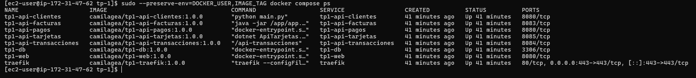
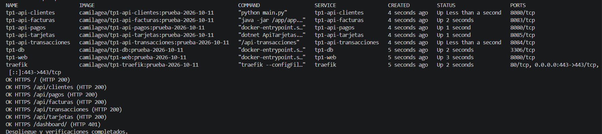
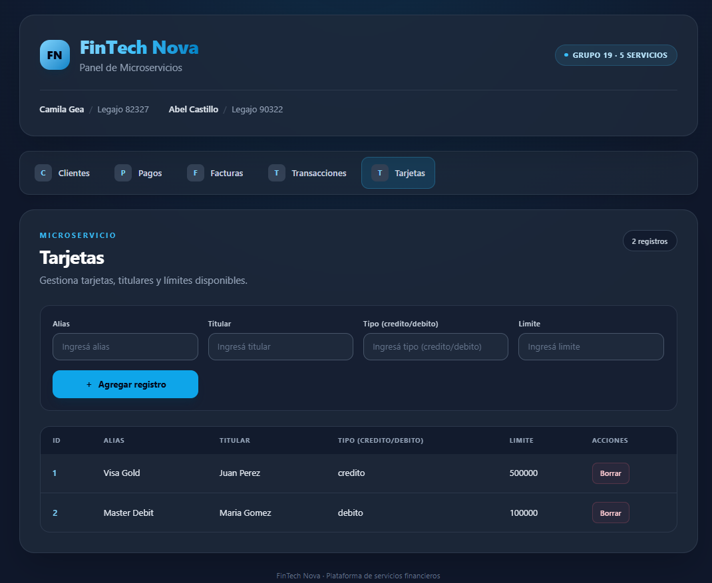
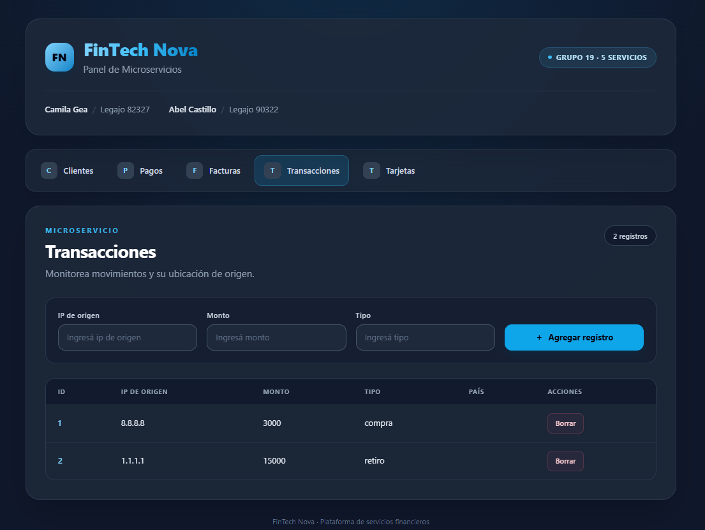
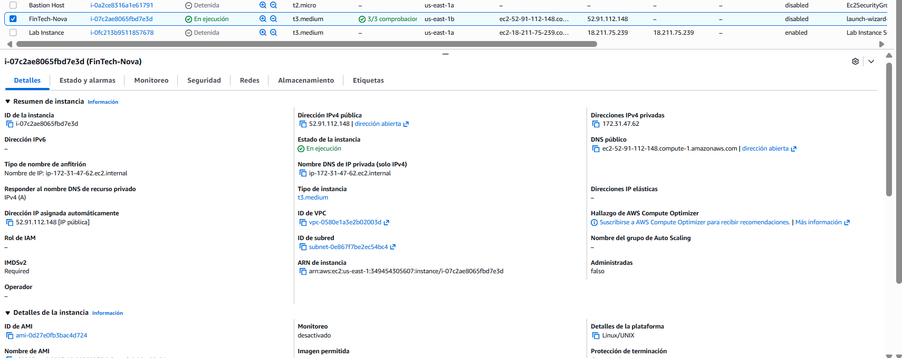

# Despliegue en AWS EC2

Este documento describe los modos de despliegue y conserva los datos de una prueba histórica de FinTech Nova en Amazon EC2.

> **Rutas CI actuales:** `deploy_aws` conecta por SSH a una EC2 preexistente con `AWS_EC2_HOST`, `AWS_EC2_USER` y `AWS_SSH_PRIVATE_KEY`; `deploy_terraform` aprovisiona y despliega en otra EC2 con Terraform. Ambos son manuales y no deben apuntar al mismo host ni ejecutarse en paralelo contra una misma instancia. Los dos transfieren las imágenes del commit desde el runner y ejecutan las verificaciones HTTPS antes de imprimir la URL. Consultar variables e instrucciones en [DEPLOY.md](DEPLOY.md).
>
> La tabla y las evidencias siguientes son históricas; no reutilizar los IDs efímeros de AMI, VPC, subnet, SG o IP en sesiones nuevas. AWS Academy requiere iniciar el Lab y renovar credenciales temporalmente. Terraform mantiene el state `fintech-nova-sandbox`; un apply posterior puede reemplazar su instancia y borrar el disco raíz (incluida la DB local). El pipeline ya no incluye jobs de probe ni de destroy; los recursos pueden expirar/resetearse por ciclo de vida del Lab.

## 1. Instancia utilizada

Para la prueba final se creó una instancia EC2 con la siguiente configuración:

| Configuración | Valor |
|---|---|
| Nombre | `FinTech-Nova` |
| Sistema operativo | Amazon Linux 2023 |
| Arquitectura | x86_64 |
| Tipo de instancia | `t3.medium` |
| Almacenamiento | 8 GiB gp3 |
| Usuario SSH | `ec2-user` |
| Puerto aplicación | HTTPS `443` |
| Región / Zona | us-east-1b |
| VPC | `vpc-0580e1a3e2b02003d` |
| Subred | `subnet-0e867f7be2ec54bc4` |
| AMI | `ami-027e0fb3bac4d724` |
| Security Group | `sg-00b25626a3e253141` (`launch-wizard-1`) |

La dirección IPv4 pública utilizada durante la última prueba fue:

```text
52.91.112.148
```

> La IP pública puede cambiar si se crea una nueva instancia o se reinicia el entorno de laboratorio. Por este motivo no se encuentra hardcodeada en los scripts.

---

## 2. Security Group

Se configuraron únicamente los accesos necesarios.

### Reglas de entrada

```text
SSH     TCP 22    -> IP pública autorizada
HTTPS   TCP 443   -> 0.0.0.0/0
```

SSH se limita a la IP utilizada para administrar la instancia.

HTTPS se permite públicamente para acceder a FinTech Nova.

No se habilitó una regla de entrada para HTTP:

```text
TCP 80
```

Tampoco se publican hacia Internet los puertos internos utilizados por las APIs o MariaDB.

### Reglas de salida

Se mantuvo habilitada la salida necesaria para que la instancia pueda:

- descargar paquetes;
- descargar imágenes desde Docker Hub;
- acceder a servicios externos utilizados por la aplicación.

---

## 3. Clave SSH

Durante la creación de la instancia se generó un Key Pair denominado:

```text
FinTech-Nova
```

La clave privada se descargó como:

```text
FinTech-Nova.pem
```

La clave no se almacena en el repositorio Git.

La conexión manual se comprobó mediante:

```sh
ssh -i <RUTA_CLAVE>/FinTech-Nova.pem ec2-user@<IP_EC2>
```

Para utilizar la clave desde WSL se almacenó una copia en el directorio personal:

```sh
cp "/mnt/c/<ruta>/FinTech-Nova.pem" ~/FinTech-Nova.pem
chmod 600 ~/FinTech-Nova.pem
```

---

## 4. Preparación de la instancia

La instancia de este procedimiento utiliza Amazon Linux 2023. Una vez copiado a EC2, `deploy.sh` instala Docker, utiliza el `curl-minimal` que normalmente ya viene instalado, habilita Docker y descarga e instala el plugin oficial de Docker Compose. Admite las arquitecturas `x86_64` y `aarch64` y verifica el checksum SHA-256 del plugin descargado. No se debe pedir a DNF instalar `curl` completo, ya que entra en conflicto con `curl-minimal`.

---

## 5. Imágenes Docker

Las imágenes utilizadas por EC2 se publican previamente en Docker Hub mediante:

```sh
bash build.sh <DOCKER_USER> <IMAGE_TAG>
```

Durante la prueba final se utilizó:

```sh
bash build.sh camilagea 1.0.0
```

Se publicaron las siguientes 8 imágenes:

```text
camilagea/tp1-traefik:1.0.0
camilagea/tp1-db:1.0.0
camilagea/tp1-api-clientes:1.0.0
camilagea/tp1-api-pagos:1.0.0
camilagea/tp1-api-facturas:1.0.0
camilagea/tp1-api-transacciones:1.0.0
camilagea/tp1-api-tarjetas:1.0.0
camilagea/tp1-web:1.0.0
```

Este es el registro del procedimiento manual histórico. Los jobs actuales de CI publican en GitLab Container Registry y transfieren las imágenes desde el runner a EC2; no se construyen dentro de la instancia.

---

## 6. Configuración del despliegue

En el flujo manual histórico, antes de transferir se genera el certificado y agrega el usuario de Traefik ejecutando localmente `bash prepare-deploy.sh <usuario-dashboard>`; el script solicita la contraseña de forma oculta. Los jobs CI generan estos archivos temporalmente y transfieren los archivos runtime a EC2. Para más detalles, consulta [DEPLOY.md](./DEPLOY.md).

El archivo `.env` incluye `DOCKER_USER` e `IMAGE_TAG`, que deben coincidir con el namespace y el tag usados al ejecutar `build.sh`, además de las credenciales de la aplicación. Desde la raíz del proyecto en la PC, se copian los archivos necesarios y se inicia el despliegue remoto:

```sh
scp -i FinTech-Nova.pem -r certs/ secrets/ .env docker-compose.yml deploy.sh ec2-user@<IP_O_DNS_EC2>:/home/ec2-user/tp-1/
ssh -i FinTech-Nova.pem ec2-user@<IP_O_DNS_EC2> "bash ~/tp-1/deploy.sh"
```

La PEM permanece en la PC: se usa para SSH/SCP y no se copia a EC2. `deploy.sh` se ejecuta en EC2 sin parámetros; el usuario y el tag de las imágenes se leen desde `.env`. Se conserva la carpeta `tp-1` porque Compose infiere de ella el nombre del proyecto; no se especifica `--project-name` en el script.

---

## 7. Archivos transferidos

La copia desde la PC transfiere a EC2 únicamente los archivos necesarios para ejecutar la aplicación:

```text
docker-compose.yml
.env
certs/
secrets/dashboard_users
deploy.sh
```

El código fuente de las APIs no necesita copiarse a EC2 porque ya se encuentra incluido en las imágenes publicadas en Docker Hub.

Los archivos sensibles no se almacenan en Git. Al ejecutarse, `deploy.sh` restringe los permisos de `.env`, `certs/local.key` y `secrets/dashboard_users`.

---

## 8. Inicio de los contenedores

El procedimiento manual documentado originalmente describía `docker compose pull`. Sin embargo, el `deploy.sh` vigente no hace pull: requiere que las imágenes ya existan localmente y ejecuta `docker compose up -d --no-build --pull never`. Por eso ambos jobs de CI hacen pull desde el runner y transfieren las imágenes con `docker save`/`docker load` antes de invocar el script.

Una vez preparada la instancia, el chequeo de estado equivale a:

```sh
docker compose pull
docker compose up -d
docker compose ps
```

`up -d` crea e inicia los contenedores.

`ps` permite comprobar su estado.

Durante la prueba final quedaron en ejecución los siguientes 8 contenedores:

```text
traefik
tp1-db
tp1-api-clientes
tp1-api-pagos
tp1-api-facturas
tp1-api-transacciones
tp1-api-tarjetas
tp1-web
```

---

## 9. Exposición de puertos

Solamente Traefik publica un puerto hacia el host:

```text
0.0.0.0:443 -> 443/tcp
```

Los demás servicios muestran únicamente sus puertos internos.

Por ejemplo:

```text
MariaDB             3306/tcp
API Clientes        8080/tcp
API Pagos           8080/tcp
API Facturas        8083/tcp
API Transacciones   8084/tcp
API Tarjetas        8085/tcp
Web                  8080/tcp
```

Esto evita exponer directamente las APIs y la base de datos hacia Internet.

---

## 10. Pruebas automáticas

Una vez levantados los contenedores, `deploy.sh` consulta mediante `curl` los endpoints HTTPS desde la propia EC2. Exige HTTP 200 para la web y las cinco rutas de API, y HTTP 401 para `/dashboard/` sin credenciales. El certificado es autofirmado, por eso las peticiones usan `curl -k`.

Esta comprobación confirma que las rutas responden con el código esperado, pero no interpreta el cuerpo ni valida el esquema JSON o las operaciones funcionales de cada API.

Durante la prueba final se obtuvo:

```text
OK HTTPS / (HTTP 200)
OK HTTPS /api/clientes (HTTP 200)
OK HTTPS /api/pagos (HTTP 200)
OK HTTPS /api/facturas (HTTP 200)
OK HTTPS /api/transacciones (HTTP 200)
OK HTTPS /api/tarjetas (HTTP 200)
OK HTTPS /dashboard/ (HTTP 401)
Despliegue y verificaciones completados.
```

Por lo tanto, no se considera exitoso el despliegue únicamente porque los contenedores aparezcan como `Up`: también se comprueba que los servicios respondan.

---

## 11. Verificación posterior

Para consultar el estado después del despliegue, desde la PC se puede ejecutar:

```sh
ssh -i FinTech-Nova.pem ec2-user@<IP_O_DNS_EC2> 'cd ~/tp-1 && sudo docker compose --env-file .env ps'
```

Los logs se consultan reemplazando `ps` por `logs`. Para detener sin borrar datos, ejecutar `sudo docker compose down` desde `~/tp-1`; luego se puede iniciar de nuevo con `sudo docker compose up -d` desde esa carpeta. No agregar `-v` si se necesita conservar la base. Las comprobaciones HTTPS se ejecutan automáticamente al correr `deploy.sh`.

---

## 12. Pruebas funcionales

Además de las verificaciones automáticas se realizaron pruebas desde la interfaz web.

### API Pagos

Se comprobó la creación de un pago en ARS y la obtención de su conversión a USD mediante el servicio externo utilizado por la API.

### API Transacciones

Se creó una transacción utilizando una dirección IP válida:

```text
8.8.4.4
```

La API externa de geolocalización respondió correctamente:

```text
United States
```

Esto permitió comprobar la comunicación de los contenedores con servicios externos desde EC2.

---

## 13. Acceso desde el navegador

Durante la última prueba la aplicación estuvo disponible en:

```text
https://52.91.112.148
```

El dashboard de Traefik estuvo disponible en:

```text
https://52.91.112.148/dashboard/
```

El dashboard requiere autenticación.

Debido a que se utiliza un certificado autofirmado, el navegador muestra una advertencia de seguridad. Esto es esperado para el entorno del Trabajo Práctico.

---

## 14. Evidencias para la entrega

Para demostrar el funcionamiento del despliegue se deben conservar capturas de:

1. instancia `FinTech-Nova` en ejecución;
2. tipo `t3.medium` y Amazon Linux 2023;
3. reglas del Security Group mostrando `22` y `443`;
4. ausencia del puerto público `80`;
5. salida de `docker compose ps` con los 8 contenedores;
6. ejecución exitosa de `deploy.sh`;
7. pruebas HTTPS de la web y las cinco APIs;
8. aplicación funcionando desde el navegador;
9. dashboard de Traefik protegido;
10. imágenes publicadas en Docker Hub.

---

## 15. Reproducibilidad

El flujo para repetir el despliegue es:

```text
PC: Docker login y build.sh
      |
      v
8 imágenes en Docker Hub
      |
      v
PC: prepare-deploy.sh genera certs y usuario BasicAuth
      |
      v
PC: scp de .env, Compose, certs, secrets y deploy.sh
      |
      v
PC: ssh para ejecutar bash ~/tp-1/deploy.sh en EC2
      |
      +--> instala/prepara Docker
      +--> instala Docker Compose
      +--> docker compose pull
      +--> docker compose up -d
      +--> verifica estados HTTP por HTTPS
      |
      v
Aplicación funcionando
```

De esta manera el despliegue puede repetirse sobre una nueva instancia sin realizar manualmente la configuración de cada contenedor.

## 16. Evidencias del despliegue

### Contenedores ejecutándose en EC2

Los ocho contenedores se encuentran en ejecución utilizando las imágenes publicadas en Docker Hub.



### Verificación HTTPS

Se verificó el acceso HTTPS a la web y a las cinco APIs.



### Imágenes publicadas en Docker Hub

Las ocho imágenes utilizadas por el despliegue se encuentran publicadas en Docker Hub.


### Aplicación funcionando en AWS

#### Tarjetas



#### Facturas


#### Pagos

La prueba de Pagos permite comprobar también la conversión de ARS a USD mediante el servicio externo.


#### Clientes


#### Transacciones

La prueba con la IP `8.8.4.4` permitió verificar la consulta al servicio externo de geolocalización.



### Configuración de EC2

La instancia utilizada fue `FinTech-Nova`, de tipo `t3.medium` sobre Amazon Linux 2023.



### Security Group

El Security Group permite SSH por el puerto `22` desde una IP autorizada y HTTPS por `443`. No existe una regla de entrada para HTTP `80`.

