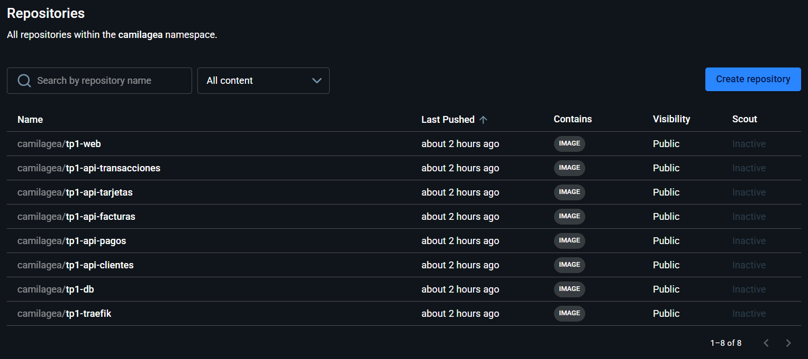
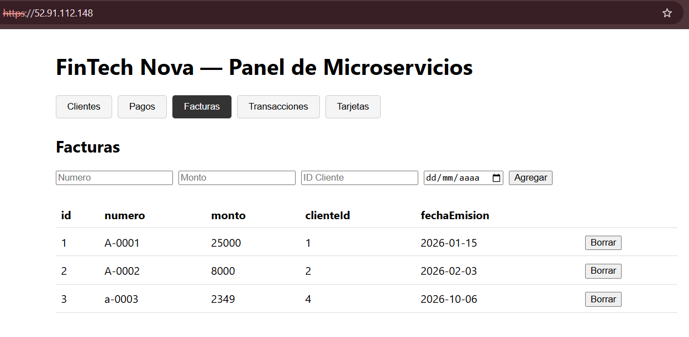
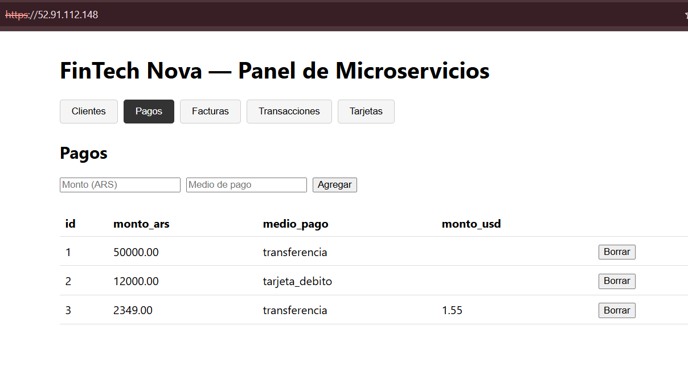
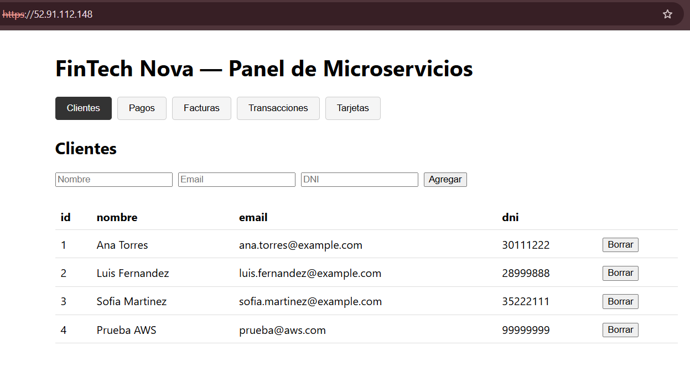
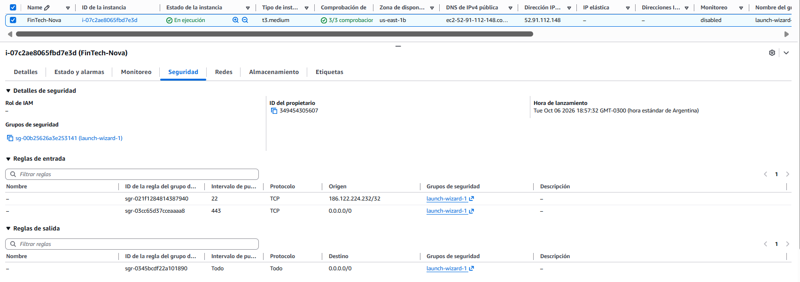

# Despliegue en AWS EC2

Este documento describe la configuración utilizada para desplegar FinTech Nova en Amazon EC2 y el procedimiento utilizado para validar el funcionamiento de la aplicación.

## 1. Instancia utilizada

Para la prueba final se creó una instancia EC2 con la siguiente configuración:

| Configuración | Valor |
|---|---|
| Nombre | `FinTech-Nova` |
| Sistema operativo | Amazon Linux 2023 |
| Arquitectura | x86_64 |
| Tipo de instancia | `t3.medium` |
| Almacenamiento | 8 GiB gp3 |
| Usuario SSH | `ec2-user` |
| Puerto aplicación | HTTPS `443` |
| Región / Zona | us-east-1b |
| VPC | `vpc-0580e1a3e2b02003d` |
| Subred | `subnet-0e867f7be2ec54bc4` |
| AMI | `ami-027e0fb3bac4d724` |
| Security Group | `sg-00b25626a3e253141` (`launch-wizard-1`) |

La dirección IPv4 pública utilizada durante la última prueba fue:

```text
52.91.112.148
```

> La IP pública puede cambiar si se crea una nueva instancia o se reinicia el entorno de laboratorio. Por este motivo no se encuentra hardcodeada en los scripts.

---

## 2. Security Group

Se configuraron únicamente los accesos necesarios.

### Reglas de entrada

```text
SSH     TCP 22    -> IP pública autorizada
HTTPS   TCP 443   -> 0.0.0.0/0
```

SSH se limita a la IP utilizada para administrar la instancia.

HTTPS se permite públicamente para acceder a FinTech Nova.

No se habilitó una regla de entrada para HTTP:

```text
TCP 80
```

Tampoco se publican hacia Internet los puertos internos utilizados por las APIs o MariaDB.

### Reglas de salida

Se mantuvo habilitada la salida necesaria para que la instancia pueda:

- descargar paquetes;
- descargar imágenes desde Docker Hub;
- acceder a servicios externos utilizados por la aplicación.

---

## 3. Clave SSH

Durante la creación de la instancia se generó un Key Pair denominado:

```text
FinTech-Nova
```

La clave privada se descargó como:

```text
FinTech-Nova.pem
```

La clave no se almacena en el repositorio Git.

La conexión manual se comprobó mediante:

```sh
ssh -i <RUTA_CLAVE>/FinTech-Nova.pem ec2-user@<IP_EC2>
```

Para utilizar la clave desde WSL se almacenó una copia en el directorio personal:

```sh
cp "/mnt/c/<ruta>/FinTech-Nova.pem" ~/FinTech-Nova.pem
chmod 600 ~/FinTech-Nova.pem
```

---

## 4. Preparación de la instancia

La preparación de EC2 se encuentra automatizada mediante `deploy.sh`.

El script verifica que la instancia corresponda a:

```text
Amazon Linux 2023
x86_64
```

Luego instala e inicia Docker:

```sh
sudo dnf install -y docker
sudo systemctl enable --now docker
```

También instala el plugin de Docker Compose cuando es necesario.

De esta manera no es necesario preparar manualmente una instancia nueva antes del despliegue.

---

## 5. Imágenes Docker

Las imágenes utilizadas por EC2 se publican previamente en Docker Hub mediante:

```sh
bash build.sh <DOCKER_USER> <IMAGE_TAG>
```

Durante la prueba final se utilizó:

```sh
bash build.sh camilagea 1.0.0
```

Se publicaron las siguientes 8 imágenes:

```text
camilagea/tp1-traefik:1.0.0
camilagea/tp1-db:1.0.0
camilagea/tp1-api-clientes:1.0.0
camilagea/tp1-api-pagos:1.0.0
camilagea/tp1-api-facturas:1.0.0
camilagea/tp1-api-transacciones:1.0.0
camilagea/tp1-api-tarjetas:1.0.0
camilagea/tp1-web:1.0.0
```

La instancia EC2 descarga estas imágenes desde Docker Hub. No se realiza la construcción de las imágenes dentro de EC2.

---

## 6. Configuración del despliegue

Antes de ejecutar el despliegue se configuraron las variables:

```sh
export EC2_HOST=52.91.112.148
export SSH_KEY="$HOME/FinTech-Nova.pem"
```

Luego se ejecutó:

```sh
bash deploy.sh deploy camilagea 1.0.0
```

`EC2_HOST` indica la instancia destino.

`SSH_KEY` indica la clave utilizada para establecer la conexión SSH.

Los argumentos:

```text
camilagea
1.0.0
```

corresponden respectivamente al namespace de Docker Hub y al tag de las imágenes.

---

## 7. Archivos transferidos

El proceso de despliegue transfiere a EC2 únicamente los archivos necesarios para ejecutar la aplicación, entre ellos:

```text
docker-compose.yml
.env
certs/
secrets/dashboard_users
```

El código fuente de las APIs no necesita copiarse a EC2 porque ya se encuentra incluido en las imágenes publicadas en Docker Hub.

Los archivos sensibles se transfieren durante el despliegue pero no se almacenan en el repositorio Git.

---

## 8. Inicio de los contenedores

Una vez preparada la instancia, el script ejecuta el equivalente a:

```sh
docker compose pull
docker compose up -d
docker compose ps
```

`pull` descarga las imágenes publicadas.

`up -d` crea e inicia los contenedores.

`ps` permite comprobar su estado.

Durante la prueba final quedaron en ejecución los siguientes 8 contenedores:

```text
traefik
tp1-db
tp1-api-clientes
tp1-api-pagos
tp1-api-facturas
tp1-api-transacciones
tp1-api-tarjetas
tp1-web
```

---

## 9. Exposición de puertos

Solamente Traefik publica un puerto hacia el host:

```text
0.0.0.0:443 -> 443/tcp
```

Los demás servicios muestran únicamente sus puertos internos.

Por ejemplo:

```text
MariaDB             3306/tcp
API Clientes        8080/tcp
API Pagos           8080/tcp
API Facturas        8083/tcp
API Transacciones   8084/tcp
API Tarjetas        8085/tcp
Web                  8080/tcp
```

Esto evita exponer directamente las APIs y la base de datos hacia Internet.

---

## 10. Pruebas automáticas

Una vez levantados los contenedores, `deploy.sh` comprueba que la aplicación responda realmente mediante HTTPS.

Durante la prueba final se obtuvo:

```text
OK HTTPS /
OK HTTPS /api/clientes
OK HTTPS /api/pagos
OK HTTPS /api/facturas
OK HTTPS /api/transacciones
OK HTTPS /api/tarjetas

Web y cinco APIs comprobadas correctamente.
El dashboard exige autenticacion.
```

Por lo tanto, no se considera exitoso el despliegue únicamente porque los contenedores aparezcan como `Up`: también se comprueba que los servicios respondan.

---

## 11. Verificación posterior

El despliegue puede verificarse nuevamente sin reinstalar ni recrear la aplicación mediante:

```sh
bash deploy.sh verify camilagea 1.0.0
```

Durante la prueba realizada se obtuvo nuevamente:

```text
OK HTTPS /
OK HTTPS /api/clientes
OK HTTPS /api/pagos
OK HTTPS /api/facturas
OK HTTPS /api/transacciones
OK HTTPS /api/tarjetas
```

Esto confirmó que la aplicación permanecía disponible luego del despliegue.

---

## 12. Pruebas funcionales

Además de las verificaciones automáticas se realizaron pruebas desde la interfaz web.

### API Pagos

Se comprobó la creación de un pago en ARS y la obtención de su conversión a USD mediante el servicio externo utilizado por la API.

### API Transacciones

Se creó una transacción utilizando una dirección IP válida:

```text
8.8.4.4
```

La API externa de geolocalización respondió correctamente:

```text
United States
```

Esto permitió comprobar la comunicación de los contenedores con servicios externos desde EC2.

---

## 13. Acceso desde el navegador

Durante la última prueba la aplicación estuvo disponible en:

```text
https://52.91.112.148
```

El dashboard de Traefik estuvo disponible en:

```text
https://52.91.112.148/dashboard/
```

El dashboard requiere autenticación.

Debido a que se utiliza un certificado autofirmado, el navegador muestra una advertencia de seguridad. Esto es esperado para el entorno del Trabajo Práctico.

---

## 14. Evidencias para la entrega

Para demostrar el funcionamiento del despliegue se deben conservar capturas de:

1. instancia `FinTech-Nova` en ejecución;
2. tipo `t3.medium` y Amazon Linux 2023;
3. reglas del Security Group mostrando `22` y `443`;
4. ausencia del puerto público `80`;
5. salida de `docker compose ps` con los 8 contenedores;
6. ejecución exitosa de `deploy.sh`;
7. pruebas HTTPS de la web y las cinco APIs;
8. aplicación funcionando desde el navegador;
9. dashboard de Traefik protegido;
10. imágenes publicadas en Docker Hub.

---

## 15. Reproducibilidad

El despliegue fue probado sobre una instancia nueva.

El flujo utilizado fue:

```text
Docker login
      |
      v
build.sh
      |
      v
8 imágenes en Docker Hub
      |
      v
Nueva EC2 Amazon Linux 2023
      |
      v
deploy.sh
      |
      +--> instala/prepara Docker
      +--> instala Docker Compose
      +--> transfiere configuración
      +--> docker compose pull
      +--> docker compose up -d
      +--> verifica HTTPS
      |
      v
Aplicación funcionando
```

De esta manera el despliegue puede repetirse sobre una nueva instancia sin realizar manualmente la configuración de cada contenedor.

## 16. Evidencias del despliegue

### Contenedores ejecutándose en EC2

Los ocho contenedores se encuentran en ejecución utilizando las imágenes publicadas en Docker Hub.


### Verificación HTTPS

Se verificó el acceso HTTPS a la web y a las cinco APIs.


### Imágenes publicadas en Docker Hub

Las ocho imágenes utilizadas por el despliegue se encuentran publicadas en Docker Hub.



### Aplicación funcionando en AWS

#### Tarjetas


#### Facturas



#### Pagos

La prueba de Pagos permite comprobar también la conversión de ARS a USD mediante el servicio externo.



#### Clientes



#### Transacciones

La prueba con la IP `8.8.4.4` permitió verificar la consulta al servicio externo de geolocalización.


### Configuración de EC2

La instancia utilizada fue `FinTech-Nova`, de tipo `t3.medium` sobre Amazon Linux 2023.


### Security Group

El Security Group permite SSH por el puerto `22` desde una IP autorizada y HTTPS por `443`. No existe una regla de entrada para HTTP `80`.

