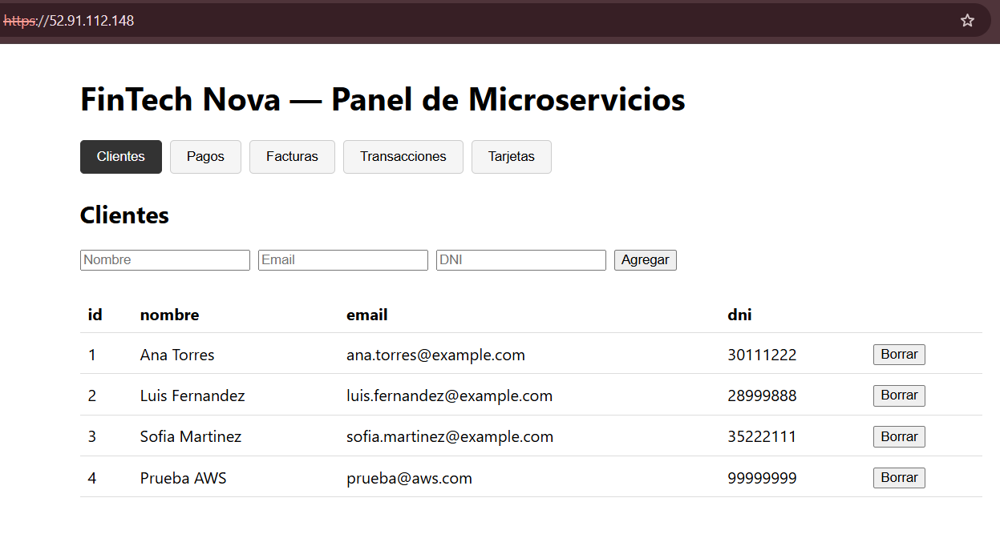
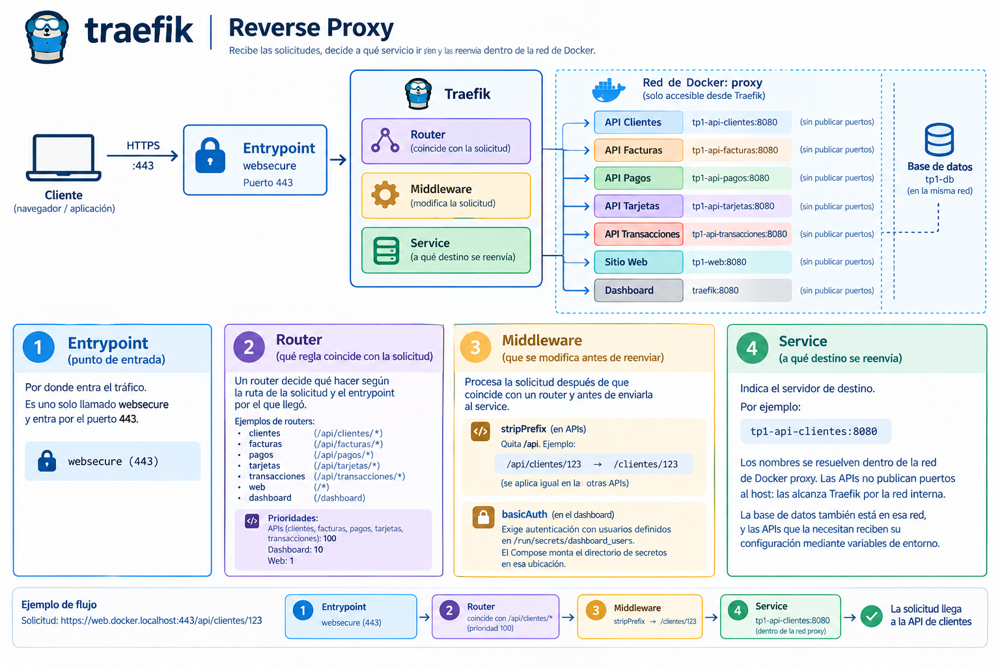
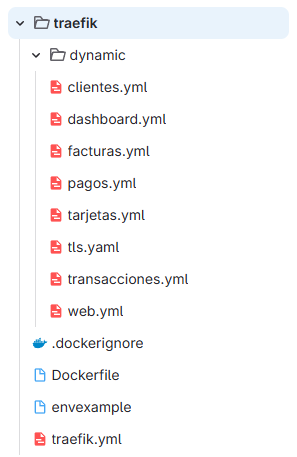
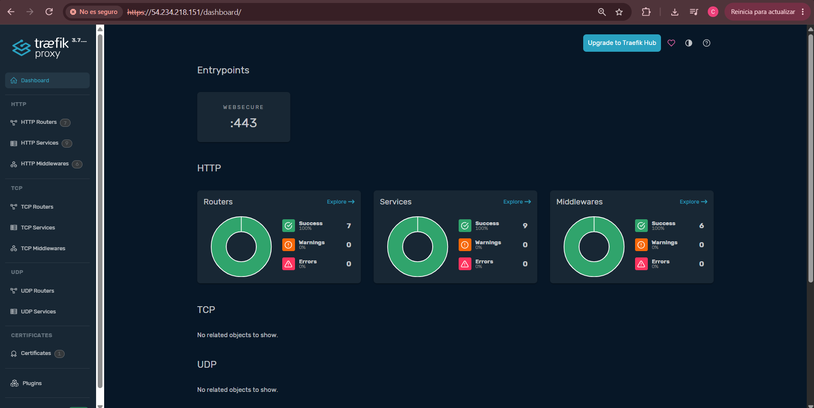
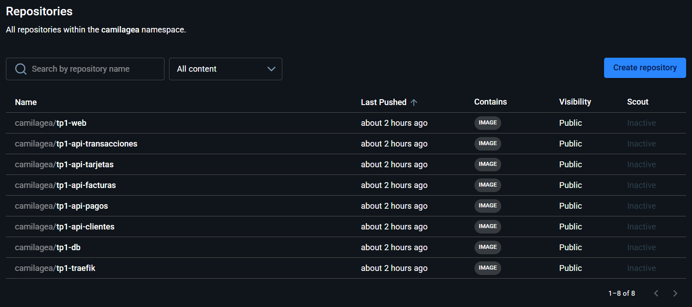
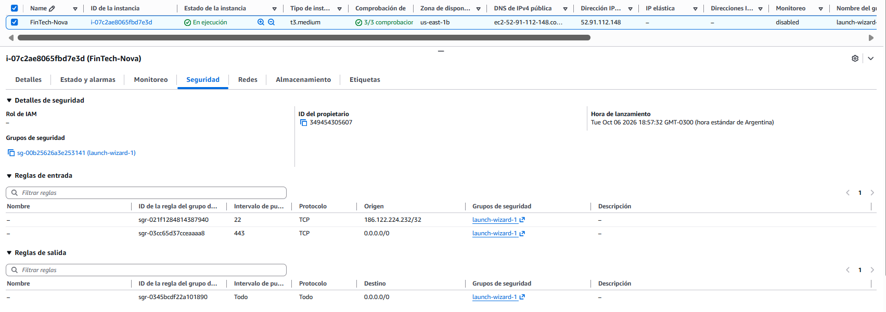
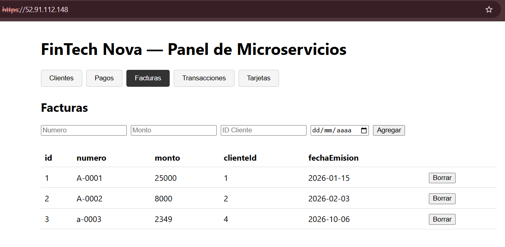

# FinTech Nova — Trabajo Práctico DevOps 2026

**Grupo 19 · Camila Gea (82327) · Abel Castillo (90322)**

FinTech Nova reúne la gestión de clientes, pagos, facturas, transacciones y tarjetas mediante una interfaz web y cinco APIs independientes. El trabajo comprende la dockerización de los componentes, su integración con Docker Compose y el despliegue en Amazon EC2 con acceso HTTPS.

El flujo CI actual publica ocho imágenes en GitLab Container Registry y despliega mediante Terraform en AWS EC2. El repositorio también conserva el procedimiento histórico de Docker Hub, una instancia compartida de MariaDB con almacenamiento persistente y scripts para construcción, preparación de archivos privados y despliegue. Este documento presenta la arquitectura, las decisiones de implementación y las evidencias de las pruebas registradas.

## 1. Arquitectura e integración


La solución está compuesta por ocho contenedores. Cada API mantiene sus dependencias y su entorno de ejecución, lo que permite construir y actualizar los componentes de forma independiente.

| Servicio | Tecnología | Responsabilidad |
|---|---|---|
| `tp1-web` | JavaScript, Vite y `serve` | Interfaz para las cinco funcionalidades |
| `tp1-api-clientes` | Python / Flask | Gestión de clientes |
| `tp1-api-pagos` | Node.js / Express | Gestión de pagos y conversión ARS/USD |
| `tp1-api-facturas` | Java / Spring Boot | Gestión de facturas |
| `tp1-api-transacciones` | Go | Gestión de transacciones y geolocalización por IP |
| `tp1-api-tarjetas` | .NET / ASP.NET Core | Gestión de tarjetas |
| `tp1-db` | MariaDB | Almacenamiento de las cinco bases de las APIs |
| `traefik` | Traefik | Entrada HTTPS, enrutamiento y dashboard |

La web permite listar, agregar y borrar registros. Las APIs también implementan operaciones de actualización, aunque la interfaz actual no incluye un formulario de edición.

Todas las APIs acceden a una única instancia de MariaDB, con una base por funcionalidad. Pagos y Transacciones consultan además servicios externos para obtener el tipo de cambio y el país asociado a una dirección IP.

Las solicitudes del navegador llegan a Traefik, que las dirige a la web o a la API correspondiente. El acceso externo se concentra en el puerto HTTPS 443; las comunicaciones internas utilizan la red Docker `proxy`.



*La web reúne las cinco funcionalidades en un mismo sitio. Las capturas corresponden a las pruebas documentadas.*

## 2. Dockerización y preparación de imágenes

Cada componente tiene un Dockerfile que define su imagen base, la instalación de dependencias, los archivos de la aplicación y el comando de inicio. Esta preparación queda registrada en el repositorio y se reproduce durante la construcción, sin instalar manualmente las dependencias de cada aplicación en EC2.

### Dependencias y construcción por etapas

Clientes instala las bibliotecas Python indicadas en `requirements.txt`. Pagos instala sus dependencias mediante `npm ci --omit=dev`. En ambos casos se copian primero los archivos de dependencias y después el código, permitiendo reutilizar la capa de instalación si solo cambia la aplicación.

Para los componentes que requieren compilación o generación de archivos se utilizan **multi-stage builds**. Una etapa contiene las herramientas de construcción y la etapa final recibe el resultado junto con el entorno necesario para ejecutarlo.

```Dockerfile
FROM maven:3.9.9-eclipse-temurin-21 AS build

WORKDIR /build
COPY api-facturas/pom.xml .
RUN mvn -B -DskipTests dependency:go-offline
COPY api-facturas/src ./src
RUN mvn -B -DskipTests package

FROM eclipse-temurin:21-jre-jammy AS runtime

WORKDIR /app
RUN useradd --system --uid 10001 --create-home appuser
COPY --from=build --chown=appuser:appuser /build/target/api-facturas.jar /app/app.jar
USER appuser

EXPOSE 8083
ENV PORT=8083
ENTRYPOINT ["java", "-jar", "/app/app.jar"]
```


En Facturas, Maven compila el código Java y genera `api-facturas.jar`. Ese archivo se copia a una etapa con Java runtime. De esta manera, Maven y las herramientas de compilación quedan fuera de la imagen final. El mismo criterio se aplica a la publicación .NET, al ejecutable Go y a los archivos de la web generados por Vite.

Ambas etapas se realizan durante la construcción de la imagen. La aplicación se inicia posteriormente, al ejecutar el contenedor. En la web, la etapa final utiliza `serve` para publicar la carpeta `dist` en el puerto 8080; el Dockerfile actual no ejecuta Nginx.

En algunas aplicaciones se configura un usuario distinto de root para reducir los privilegios del proceso dentro del contenedor. Esta medida está implementada en Facturas, Tarjetas y Web.

### Configuración incorporada y arquitectura de destino

La imagen de MariaDB incorpora `init-scripts/` en `/docker-entrypoint-initdb.d/`. Estos archivos preparan las bases, permisos y tablas durante la primera inicialización. La imagen de Traefik incorpora `traefik.yml` y `dynamic/`, asociando las reglas de enrutamiento a la versión publicada.

Los contextos utilizados por `scripts/build.sh` coinciden con las rutas de copia de cada Dockerfile: Traefik utiliza su carpeta; MariaDB, Clientes y Pagos, sus respectivas carpetas; los otros componentes de aplicación utilizan `aplicaciones-contenedores`.

El build genera imágenes para `linux/amd64`, en correspondencia con la instancia x86_64 documentada. La compilación Go también fija esa arquitectura e incorpora certificados CA en la imagen final para consultar servicios externos mediante HTTPS.

**Implementación:** [Dockerfile de Facturas](aplicaciones-contenedores/api-facturas/Dockerfile), [Dockerfile de Web](aplicaciones-contenedores/web/Dockerfile), [Dockerfile de MariaDB](aplicaciones-contenedores/db/Dockerfile) y [Dockerfile de Traefik](traefik/Dockerfile).

## 3. Orquestación, configuración y persistencia

```yaml
# docker-compose.yml
  tp1-api-clientes:
    image: ${DOCKER_USER}/tp1-api-clientes:${IMAGE_TAG}
    container_name: tp1-api-clientes
    environment:
      - DB_HOST=${DB_HOST}
      - DB_PORT=${DB_PORT}
      - DB_NAME=${DB_NAME_CLIENTES}
      - DB_USER=${DB_USER}
      - DB_PASSWORD=${DB_PASSWORD}
    networks:
      - proxy
    restart: always
    deploy:
      resources:
        limits:
          cpus: "0.25"
          memory: 256M
    depends_on:
      - tp1-db
```

[docker-compose.yml](docker-compose.yml) define la ejecución de los ocho servicios mediante imágenes publicadas. No contiene una sección de construcción local: el entorno de EC2 descarga las imágenes y ejecuta sus contenedores.

### Selección de imágenes

Las referencias utilizan `DOCKER_USER` e `IMAGE_TAG` para seleccionar el namespace del registry y una versión común. En el procedimiento histórico local se utilizaba Docker Hub; los jobs CI actuales configuran el path de GitLab Container Registry:

```yaml
image: ${DOCKER_USER}/tp1-api-clientes:${IMAGE_TAG}
```

Esta estructura permite cambiar la publicación utilizada sin editar las ocho referencias individualmente. Los valores deben coincidir con los argumentos empleados al ejecutar `scripts/build.sh`.

### Red y variables de entorno

Los servicios se conectan a la red `proxy` y se encuentran por sus nombres. Las APIs acceden a MariaDB mediante `tp1-db:3306`, sin publicar el puerto 3306 al exterior. Compose publica únicamente `443:443` en Traefik.

La configuración se centraliza en un único archivo `.env`, en lugar de utilizar uno por microservicio. Compose toma sus valores y entrega a cada contenedor las variables declaradas en `environment`.

| Variables | Aplicación |
|---|---|
| `DOCKER_USER`, `IMAGE_TAG` | Cuenta y versión de las imágenes |
| `DB_HOST`, `DB_PORT` | Conexión interna a MariaDB |
| `DB_USER`, `DB_PASSWORD` | Usuario compartido de aplicación |
| `MYSQL_ROOT_PASSWORD`, `MYSQL_DATABASE` | Inicialización de MariaDB |
| `DB_NAME_CLIENTES`, `DB_NAME_PAGOS`, `DB_NAME_FACTURAS`, `DB_NAME_TRANSACCIONES`, `DB_NAME_TARJETAS` | Base utilizada por cada API |
| `IPAPI_TOKEN` | Token entregado a Transacciones |

[env.example](env.example) documenta la configuración esperada sin credenciales privadas. Para una instalación nueva se copia como `.env` y se completan los valores; el archivo real se mantiene fuera de Git. La variable `DOMAIN` se entrega a Traefik, aunque las reglas actuales seleccionan solicitudes por ruta y no por dominio.

### Bases y almacenamiento persistente

MariaDB aloja `db_clientes`, `db_pagos`, `db_facturas`, `db_transacciones` y `db_tarjetas`. El script inicial crea las bases y concede permisos al mismo usuario de aplicación; los SQL numerados preparan las tablas. La separación es lógica: las bases comparten servidor, recursos y usuario.

El volumen `db_data` se monta en `/var/lib/mysql`. Al reemplazar el contenedor y reutilizar el mismo volumen, los datos permanecen disponibles. El despliegue habitual conserva ese volumen; `docker compose down -v` lo elimina junto con sus datos.

### Recursos y arranque

Traefik y MariaDB tienen límites de 0,50 CPU y 512 MB; cada API y la web tienen límites de 0,25 CPU y 256 MB. Estos valores acotan los recursos configurados en una instancia compartida y no representan mediciones de consumo.

Todos los servicios utilizan `restart: always`. Las APIs declaran `depends_on` para ordenar el arranque de MariaDB antes que ellas. Esta dependencia no verifica que la base ya esté disponible; los reintentos del despliegue contemplan el tiempo de inicialización.

## 4. Traefik, enrutamiento y HTTPS

Traefik es el proxy de entrada: recibe las solicitudes HTTPS, selecciona un router según la ruta y las dirige al servicio correspondiente. El siguiente esquema resume cómo se organiza su configuración y el recorrido de las solicitudes.



### 4.0. Estructura de configuración


### 4.1. Configuración estática: entrypoint y providers

El archivo [traefik/traefik.yml](traefik/traefik.yml) contiene la configuración estática de Traefik. Este es su contenido completo:

```yaml
## traefik.yml
api:
  insecure: false
  dashboard: true
entrypoints:
  websecure:
    address: ":443"
    http:
      tls: true
providers:
  docker:
    exposedByDefault: false
    network: proxy
  file:
    directory: /dynamic
    watch: true
log:
  level: INFO
accessLog: true
```

- **Entrypoint:** es el punto de entrada del tráfico. En esta configuración hay uno llamado `websecure`, que escucha en el puerto 443 y habilita TLS.
- **API y dashboard:** `dashboard: true` activa el dashboard integrado; `insecure: false` evita exponerlo mediante el modo inseguro, sin la protección del router que se muestra más abajo.
- **Providers:** el provider `file` lee la configuración dinámica de `/dynamic` y observa cambios. El provider `docker` está habilitado, pero `exposedByDefault: false` impide exponer automáticamente todos los contenedores; las rutas que explicamos aquí están declaradas en los archivos dinámicos.
- **Logs:** `level: INFO` establece el nivel general de registro y `accessLog: true` habilita el registro de solicitudes.

### 4.2. TLS: certificado que usa el entrypoint

El archivo [traefik/dynamic/tls.yaml](traefik/dynamic/tls.yaml) indica a Traefik qué certificado y clave utilizar. Se muestra completo:

```yaml
tls:
  certificates:
    - certFile: /certs/local.crt
      keyFile:  /certs/local.key
```

TLS cifra la conexión entre el navegador y Traefik y permite que el servidor presente su certificado. La clave privada indicada por `keyFile` es sensible y debe mantenerse protegida. En los servicios de destino, las URLs están configuradas con `http://`, por lo que la terminación TLS ocurre en Traefik.

### 4.3. Ejemplo de microservicio: router de Clientes

El archivo [traefik/dynamic/clientes.yml](traefik/dynamic/clientes.yml) muestra el patrón aplicado a las APIs. Su contenido completo es:

```yaml
enable: true
http:
  routers:
    clientes:
      rule: "PathPrefix(`/api/clientes`)"
      entrypoints:
        - websecure
      tls: true
      middlewares:
        - clientes-strip
      service: tp1-api-clientes
      priority: 100
  middlewares:
    clientes-strip:
      stripPrefix:
        prefixes:
          - "/api"
  services:
    tp1-api-clientes:
      loadBalancer:
        servers:
          - url: "http://tp1-api-clientes:8080"
```

En este bloque aparecen los tres elementos principales del enrutamiento:

- **Router (`clientes`):** coincide con las solicitudes cuyo path empieza por `/api/clientes`, siempre que hayan entrado por `websecure`. Su prioridad es `100`.
- **Middleware (`clientes-strip`):** procesa la solicitud antes de reenviarla y elimina el prefijo `/api`. Por ejemplo, `/api/clientes/123` llega a la API como `/clientes/123`, conservando el resto de la ruta.
- **Service (`tp1-api-clientes`):** define el destino `http://tp1-api-clientes:8080`. El nombre del contenedor se resuelve en la red interna de Docker; la API recibe tráfico a través de Traefik, sin publicar ese puerto como entrada externa.

Las otras cuatro APIs repiten este patrón y cambian el path, el nombre del middleware, el servicio y el puerto de destino:

| Router | Regla | Service de destino | Prioridad |
|---|---|---|---:|
| Clientes | `/api/clientes` | `tp1-api-clientes:8080` | 100 |
| Pagos | `/api/pagos` | `tp1-api-pagos:8080` | 100 |
| Facturas | `/api/facturas` | `tp1-api-facturas:8083` | 100 |
| Transacciones | `/api/transacciones` | `tp1-api-transacciones:8084` | 100 |
| Tarjetas | `/api/tarjetas` | `tp1-api-tarjetas:8085` | 100 |
| Dashboard | `/dashboard` o `/api` | `api@internal` | 10 |
| Web | `/` | `tp1-web:8080` | 1 |

Las prioridades resuelven el solapamiento de prefijos: el router de una API tiene prioridad `100`, por encima del router del dashboard (`10`), que también contempla `/api`. La web usa `PathPrefix(`/`)` como ruta general, con prioridad `1`. Así, las reglas específicas de las APIs prevalecen y las demás solicitudes pueden llegar al sitio.

### 4.4. Dashboard y autenticación

El archivo [traefik/dynamic/dashboard.yml](traefik/dynamic/dashboard.yml) configura el router del dashboard y su middleware. Se incluye completo:

```yaml
enable: true
http:
  routers:
    dashboard:
      rule: "PathPrefix(`/dashboard`) || PathPrefix(`/api`)"
      entrypoints:
        - websecure
      service: api@internal
      tls: true
      middlewares:
        - dashboard-auth
      priority: 10
  middlewares:
    dashboard-auth:
      basicAuth:
        usersFile: /run/secrets/dashboard_users
```

El router `dashboard` coincide con `/dashboard` y con `/api`, usa el servicio interno `api@internal` y pasa cada solicitud por el middleware `dashboard-auth`. Ese middleware activa **BasicAuth** y obtiene las credenciales desde `/run/secrets/dashboard_users`.



La autenticación protege el dashboard, que da acceso a la información y funciones de administración de Traefik, para que no quede disponible para cualquier visitante. El archivo de usuarios guarda hashes de contraseña en vez de contraseñas en texto plano. Por eso es información sensible: no se deben publicar ni incluir en el README las contraseñas o sus hashes. Esta protección está asociada al router del dashboard; no se aplica a los routers de las APIs.

## 5. Automatización de construcción y publicación

[scripts/build.sh](scripts/build.sh) conserva el flujo histórico de construcción y publicación de las ocho imágenes en Docker Hub. Se ejecuta en la PC con Docker iniciado y una sesión previa en el registro:

```bash
docker login
bash scripts/build.sh camilagea prueba-2026-10-11
```

La cuenta y el tag del ejemplo corresponden a la prueba documentada y se reemplazan para otra publicación. El script valida los argumentos, comprueba Docker y verifica la existencia de los Dockerfiles. Después construye todas las imágenes con `--pull` y `--platform linux/amd64`.

Solo cuando las ocho construcciones terminaron correctamente comienza la publicación. Un fallo de construcción detiene el proceso antes de subir imágenes; un fallo de envío puede dejar una publicación parcial.



Se publican `tp1-traefik`, `tp1-db`, las cinco `tp1-api-*` y `tp1-web`, bajo la misma cuenta y tag. EC2 descarga estas imágenes durante el despliegue. Los tags pueden reemplazarse si se vuelven a publicar; para distinguir entregas conviene utilizar una versión nueva.

## 6. Creación y configuración de EC2

La instancia y su Security Group se preparan antes de ejecutar el despliegue. La prueba desde cero realizada el 11 de octubre de 2026 utilizó el siguiente entorno:

| Configuración | Valor documentado |
|---|---|
| Nombre | `FinTech-Nova-Prueba` |
| Sistema operativo | Amazon Linux 2023 |
| Arquitectura | x86_64 |
| Tipo | `t3.medium` |
| Almacenamiento | 8 GiB gp3 |
| Usuario SSH | `ec2-user` |
| Región y zona | us-east-1 / us-east-1b |
| IP de la prueba registrada | `52.91.112.148` |
| ID de instancia | `i-07c2ae8065fbd7e3d` |
| Imágenes utilizadas | `camilagea/*:prueba-2026-10-11` |


Durante la creación se generó un par de claves y se descargó el archivo `Nombre_ FinTech-Nova-Prueba.pem`. El archivo privado permanece en la PC y se utiliza para autenticar las conexiones SSH y las transferencias SCP. Es distinto de la clave TLS de Traefik.

El Security Group permite SSH por TCP 22 desde la IP autorizada y HTTPS por TCP 443 desde `0.0.0.0/0`. No se habilita el puerto 80 ni los puertos internos de las APIs o MariaDB. La salida permite instalar paquetes, descargar imágenes y consultar las APIs externas.



La IP registrada identifica la prueba documentada y no constituye una dirección garantizada para el entorno actual. `deploy.sh` no crea la instancia ni configura estas reglas.

## 7. Preparación, transferencia y despliegue

El flujo separa las responsabilidades de los tres scripts:

```text
PC: scripts/build.sh → ocho imágenes en Docker Hub
PC: scripts/prepare-deploy.sh → certificado, clave TLS y usuario del dashboard
PC: SCP → archivos de ejecución en EC2
EC2: deploy.sh → instalación, descarga, inicio y verificaciones
```

### Preparación de archivos privados

[scripts/prepare-deploy.sh](scripts/prepare-deploy.sh) se ejecuta en la PC con Docker iniciado y OpenSSL disponible:

```bash
bash scripts/prepare-deploy.sh camila
```

Solicita dos veces la contraseña sin mostrarla y utiliza `htpasswd` en un contenedor temporal para generar el hash. Agrega el usuario a `secrets/dashboard_users` y rechaza nombres duplicados.

También genera el certificado y la clave TLS. Cada ejecución reemplaza ese par; los usuarios nuevos se agregan al archivo. Las carpetas `certs/` y `secrets/` deben existir previamente. La clave privada y el archivo de usuarios quedan con permisos 600.

### Transferencia y ejecución remota

Se copian Compose, `.env`, certificados, usuarios y `scripts/deploy.sh`. El código fuente no necesita transferirse porque ya está en las imágenes; la PEM se utiliza desde la PC y no se copia a EC2. Al copiar el archivo desde `scripts/`, SCP lo deja con el nombre `deploy.sh` en el destino.

```bash
scp -i "RUTA_CLAVE.pem" -r certs/ secrets/ .env docker-compose.yml scripts/deploy.sh ec2-user@IP_EC2:/home/ec2-user/tp-1/
ssh -i "RUTA_CLAVE.pem" ec2-user@IP_EC2 'bash ~/tp-1/deploy.sh'
```

`IP_EC2` y la ruta de la clave deben ajustarse al entorno. Los scripts se ejecutan con Bash; en Windows se utiliza un entorno que lo proporcione, como WSL o Git Bash.

Dentro de EC2, el archivo [scripts/deploy.sh](scripts/deploy.sh) se copia como `deploy.sh` y:

1. Comprueba los archivos requeridos y restringe permisos de los privados.
2. Instala Docker, habilita su servicio y comprueba curl.
3. Descarga el plugin Compose y verifica el checksum SHA-256 antes de instalarlo.
4. Valida Compose y las ocho referencias de imágenes.
5. Ejecuta `pull`, `up -d` y `ps`.
6. Exige ocho contenedores en ejecución y verifica las rutas HTTPS.

El script no compila aplicaciones ni elimina volúmenes. Se conserva la carpeta `~/tp-1` porque Compose deduce de ella el nombre del proyecto, relevante para reutilizar su volumen. El instalador contempla distintas arquitecturas para Compose, pero las imágenes del build actual están preparadas para amd64.

Para consultar el estado y diagnosticar un servicio, desde esa carpeta:

```bash
sudo docker compose ps
sudo docker compose logs --tail 100 tp1-api-clientes
```

## 8. Verificaciones y evidencias funcionales

El despliegue comprueba el estado de los contenedores y las respuestas de las rutas. Las verificaciones HTTP se ejecutan desde EC2 contra `https://127.0.0.1`, con reintentos para contemplar el tiempo de arranque.


| Ruta | Código esperado |
|---|---|
| `/` | 200 |
| `/api/clientes` | 200 |
| `/api/pagos` | 200 |
| `/api/facturas` | 200 |
| `/api/transacciones` | 200 |
| `/api/tarjetas` | 200 |
| `/dashboard/` sin credenciales | 401 |


El script comprueba códigos HTTP, no el contenido JSON ni todas las operaciones. Utiliza `curl -k` por el certificado autofirmado y no verifica su confianza. La consulta local tampoco reemplaza una prueba de acceso desde Internet.

Las pruebas desde la interfaz complementan esa comprobación. La documentación previa registra una operación de Pagos con conversión ARS/USD y una transacción con la IP `8.8.4.4`, cuyo país obtenido fue `United States`. En la nueva prueba se comprobó el acceso público a la web, se renovaron las capturas de las cinco secciones y se accedió al dashboard después de preparar el usuario `camila`.


### Otras funcionalidades

Las siguientes capturas documentan las secciones de Tarjetas y Facturas. La sección Clientes se muestra junto a la arquitectura. Las imágenes corresponden a las pruebas realizadas, no a una comprobación en vivo de AWS.




## 9. Problemas encontrados y soluciones

### Conexiones HTTPS desde Go

La consulta de geolocalización fallaba por falta de certificados CA en la imagen. Se incorporó `ca-certificates` a Alpine para verificar las conexiones con el proveedor externo. Estos certificados de confianza son distintos del certificado autofirmado utilizado para recibir HTTPS en Traefik.

### Límite de consultas e IP inválida

El proveedor de geolocalización alcanzó su límite de consultas. Se configuró el token mediante `IPAPI_TOKEN`, manteniéndolo fuera del código y de Git. Otra prueba utilizó `3` como IP y guardó la transacción sin país; se repitió con `8.8.4.4` y se agregó una comprobación de IPv4 en la web. Esa validación no está implementada de la misma manera en el manejador de creación de Go.

### Credenciales persistidas en MariaDB

Cambiar las credenciales de `.env` no actualizaba los usuarios existentes: el volumen conservaba el estado anterior y las variables de inicialización se aplican al crear un directorio de datos nuevo. Durante pruebas sin información que conservar se recreó el volumen. En una base con datos, eliminarlo no es una solución adecuada: corresponde ajustar las credenciales en MariaDB.

### Tiempos de arranque y Bad Gateway

Las APIs podían iniciar mientras MariaDB todavía no aceptaba conexiones; Traefik también podía recibir solicitudes antes de que su destino estuviera disponible. Se esperó la inicialización y se incorporaron reintentos en las verificaciones. `depends_on` establece orden de inicio, no disponibilidad.

### Scripts de Windows

Los finales de línea CRLF produjeron errores al ejecutar scripts en Linux. Se convirtieron a LF y se configuró `.gitattributes`.

### Herramientas

La instalación del paquete completo `curl` entraba en conflicto con `curl-minimal` en Amazon Linux. El deploy se ajustó para instalar Docker y utilizar el curl disponible. El plugin Compose se descarga por separado.


## 10. Pipeline actual de GitLab CI/CD

Además del procedimiento histórico ejecutado desde una PC que se describe en las secciones anteriores, el repositorio cuenta con un pipeline GitLab que construye las imágenes para GitLab Container Registry, ejecuta controles y despliega automáticamente mediante Terraform tras un pipeline exitoso de `main`. El bloque de Docker Hub de la sección 5 corresponde a la publicación histórica mediante `build.sh`; no describe el registry utilizado por los jobs actuales.

### Flujo del pipeline

Las etapas se ejecutan en este orden:

1. **Test:** `prueba_pipeline` y `validar_terraform`. Este último ejecuta fmt/validate para `infra/aws`; no aprovisiona recursos ni valida el backend remoto.
2. **Build:** ocho jobs independientes construyen y publican Traefik, MariaDB, las cinco APIs y Web en GitLab Container Registry con el tag del commit.
3. **Security:** se valida Compose, se ejecutan Hadolint, Semgrep, Trivy, Yamllint y Gitleaks. Trivy analiza las ocho imágenes y bloquea ante hallazgos `HIGH` o `CRITICAL` corregibles; los que todavía no tienen corrección se excluyen con `--ignore-unfixed`.
4. **Deploy:** `deploy_terraform` se ejecuta automáticamente, y solo en el pipeline de tipo `push` de `main`, cuando las etapas anteriores terminan correctamente. En particular, el merge de una rama `feature/*` a `main` produce el pipeline que despliega. Las imágenes se descargan en el runner y se transfieren porque `deploy.sh` usa `--pull never`.

### Política automática de despliegue

Se retiró el job legacy `deploy_aws`. El único job de despliegue es `deploy_terraform`, que aprovisiona o actualiza la instancia Terraform y luego transfiere imágenes y configuración, ejecuta `deploy.sh` y espera sus verificaciones HTTPS.

La regla CI se basa en el evento `push` a `main`, no en el nombre de la rama fuente: una vez integrado un cambio de `feature/*`, GitLab crea el pipeline de `main` y ese pipeline despliega automáticamente. GitLab no conserva la rama fuente como variable de un pipeline normal de push; por ello, la regla también desplegaría otros commits que lleguen a `main`. Para que la política operativa sea “solo cambios de `feature/*`”, proteger `main`, impedir pushes directos y aceptar cambios únicamente mediante merge requests desde ramas con ese prefijo.

El AWS Academy Learner Lab debe estar activo y sus variables protegidas deben estar actualizadas antes del merge que dispare el deploy. Tras completar las verificaciones, el job imprime `https://<IP>/` y `https://<IP>/dashboard/`. El certificado es autofirmado.

### State y ciclo de vida Terraform

`deploy_terraform` conserva un state remoto fijo llamado `fintech-nova-sandbox`; no se crea un state por pipeline. El sufijo y el key pair cambian por ejecución, así que cada deploy automático puede reemplazar la instancia registrada en ese state. La instancia tiene un volumen root EBS con `delete_on_termination`; el reemplazo elimina ese disco y se pierden la base local y los demás datos no respaldados. **Con la política automática, esto puede suceder en cada merge a `main`; no usar la base de esa EC2 para datos que deban persistir.**

No hay un job `destroy_ec2` ni una etapa de cleanup: el pipeline no ofrece una acción para terminar la instancia. AWS Academy puede expirar o resetear recursos al vencer la sesión. El `terraform init` de `deploy_terraform` valida el backend al iniciar el flujo. Si todavía existe el state desechable antiguo `fintech-state-probe`, eliminarlo manualmente desde GitLab solo después de comprobar que es el state de prueba.

El job Terraform aplica limpieza local con `umask 077` y un `trap` para borrar la clave privada efímera, el plan, las credenciales temporales de Docker y otros archivos del runner, también si falla. No elimina desde EC2 el `.env`, el certificado ni las credenciales del dashboard que la aplicación necesita en runtime.

Los scripts operativos se agrupan en `scripts/`: [build.sh](scripts/build.sh), [build-ci.sh](scripts/build-ci.sh), [prepare-deploy.sh](scripts/prepare-deploy.sh), [setup-ec2.sh](scripts/setup-ec2.sh), [deploy.sh](scripts/deploy.sh), [deploy-ci.sh](scripts/deploy-ci.sh) y [find-vulnerabilities.ps1](scripts/find-vulnerabilities.ps1). Se preserva su función; el pipeline construye las imágenes mediante sus jobs declarados y `deploy_terraform` llama al helper después de terminar `init`, `plan` y `apply`. Los scripts de inicialización DB y pruebas de cada API permanecen junto al componente que los consume.

Para el detalle de variables, operación por sesión del Sandbox y pasos de cada ruta, consultar [DEPLOY.md](DEPLOY.md). La política de seguridad y el estado de Trivy se describen en [SEGURIDAD.md](SEGURIDAD.md) y [ANALISIS.md](ANALISIS.md).

## 11. Resultado y documentación complementaria

La nueva prueba desde cero documenta la publicación de las ocho imágenes con el tag `prueba-2026-10-11`, la ejecución de los ocho servicios en una EC2 nueva, las respuestas HTTPS esperadas, el acceso público al frontend y al dashboard y la persistencia del cliente de prueba después de recrear MariaDB. La documentación de pruebas anteriores registra además las consultas externas de Pagos y Transacciones.

Los scripts separan construcción, preparación y despliegue. La configuración privada se suministra al ejecutar los servicios; las credenciales reales y las claves privadas se mantienen fuera del repositorio y de las imágenes públicas. La prueba realizada no constituye una validación exhaustiva de todas las operaciones de las APIs.

Los siguientes documentos amplían los procedimientos. La arquitectura, el flujo de despliegue, las evidencias y los problemas principales quedan desarrollados en este README:

- [DEPLOY.md](DEPLOY.md): procedimiento de construcción, preparación y despliegue.
- [scripts/README.md](scripts/README.md): inventario y uso de los scripts operativos.
- [docs/adr/README.md](docs/adr/README.md): decisiones de arquitectura (ADRs), alternativas y consecuencias.
- [SEGURIDAD.md](SEGURIDAD.md): medidas de acceso y tratamiento de archivos privados.
- [AWS_EC2.md](AWS_EC2.md): configuración y registro de la prueba en AWS.
- [ERRORES.md](ERRORES.md): detalle de incidencias documentadas.
- [docs/runbooks/README.md](docs/runbooks/README.md): procedimientos de despliegue y respuesta operativa.
- [docs/postmortems/README.md](docs/postmortems/README.md): análisis de incidentes, impacto y acciones preventivas.
- [Enunciado del TP](Enunciado-TP-Parte-1.md): requisitos y alcance de la entrega.


## Tests automáticos agregados (API Clientes)

El job `test_api_clientes` ejecuta tres pruebas con `unittest` y el cliente de pruebas de Flask **antes de Build**: salud (`GET /` → 200), listado simulado de clientes (`GET /clientes` → 200) y cliente inexistente (`GET /clientes/999` → 404). La conexión a MariaDB se simula mediante `unittest.mock`, por lo que el job no necesita una base real ni credenciales. Si falla una prueba, el job falla y no avanza a Build. No reemplaza las verificaciones HTTPS posteriores al despliegue.

Para ejecutarlas localmente: `cd aplicaciones-contenedores/api-clientes`, instalar `requirements.txt` y correr `python -m unittest discover -s tests -p 'test_*.py' -v`.

## Evidencias de la Parte 2 y Terraform

- [Extracto del despliegue exitoso del 9/11/2026](docs/evidencias/parte-2-despliegue-terraform.md): ocho contenedores activos, base healthy y siete verificaciones HTTPS con el tag `9e4ea77f`.
- Capturas de Parte 1: conservadas en `docs/evidencias/`, **no corresponden a la última sesión Terraform**.
- **Pendiente antes de entregar:** agregar capturas reales de la misma sesión de AWS Academy para el pipeline completo, job `deploy_terraform` (incluyendo `terraform apply`), EC2 creada y aplicación abierta en HTTPS. Guardarlas en `docs/evidencias/` y enlazarlas aquí.

El despliegue Terraform ahora es automático en los pipelines `push` de `main`, después de superar los controles previos. Mergear `feature/*` inicia el pipeline que despliega; para limitar el origen de cambios, `main` debe estar protegida y aceptar únicamente merge requests con ese prefijo.
