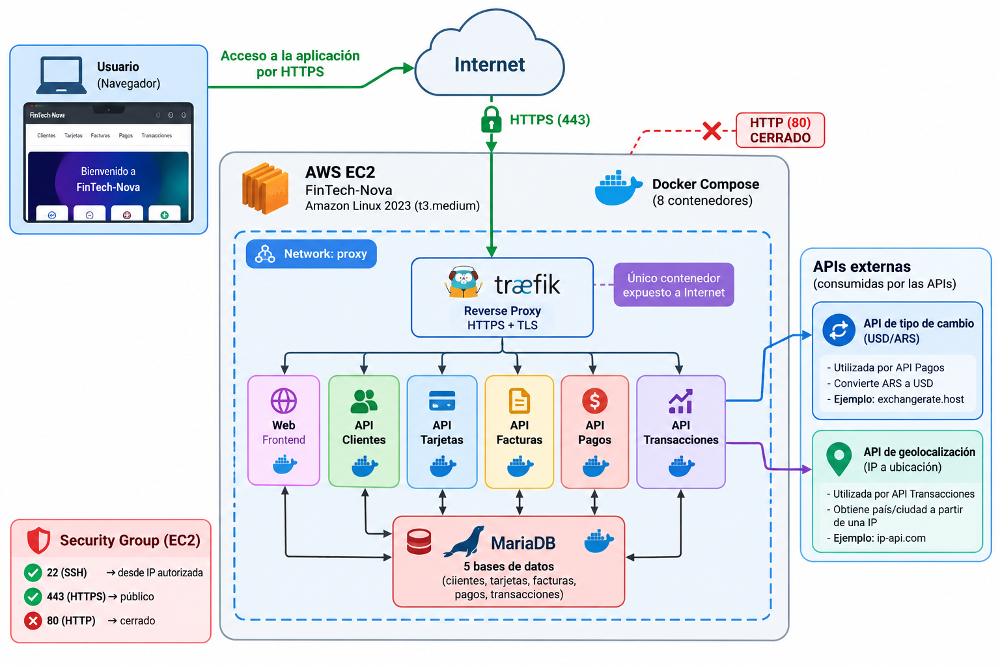

# FinTech Nova — Trabajo Práctico DevOps 2026

Proyecto desarrollado para el Trabajo Práctico de la materia DevOps.

FinTech Nova es una aplicación basada en microservicios que permite administrar clientes, pagos, facturas, transacciones y tarjetas. Cada funcionalidad se implementa mediante una API independiente y los datos se almacenan en MariaDB.

La solución se ejecuta completamente mediante contenedores Docker y utiliza Traefik como punto de entrada HTTPS.

## Arquitectura

La solución está compuesta por 8 contenedores:

| Servicio | Tecnología | Función |
|---|---|---|
| `traefik` | Traefik | Reverse proxy, HTTPS y enrutamiento |
| `tp1-db` | MariaDB | Base de datos |
| `tp1-api-clientes` | Python | Gestión de clientes |
| `tp1-api-pagos` | Node.js | Gestión de pagos y conversión de moneda |
| `tp1-api-facturas` | Java | Gestión de facturas |
| `tp1-api-transacciones` | Go | Gestión de transacciones y geolocalización por IP |
| `tp1-api-tarjetas` | .NET | Gestión de tarjetas |
| `tp1-web` | Vite / Node.js | Interfaz web |

Todos los servicios se encuentran conectados a la red Docker `proxy`.

Traefik es el único servicio expuesto hacia Internet mediante el puerto HTTPS `443`. Las APIs y MariaDB solamente son accesibles dentro de la red Docker.

### Diagrama de arquitectura



Las APIs de Pagos y Transacciones también realizan consultas a servicios externos para conversión de moneda y geolocalización de direcciones IP respectivamente.

## Docker Hub

Las imágenes utilizadas por el proyecto se publican en Docker Hub bajo un mismo namespace y tag.

Imágenes:

```text
tp1-traefik
tp1-db
tp1-api-clientes
tp1-api-pagos
tp1-api-facturas
tp1-api-transacciones
tp1-api-tarjetas
tp1-web
```

El archivo `docker-compose.yml` utiliza las variables:

```text
DOCKER_USER
IMAGE_TAG
```

De esta manera se puede seleccionar el usuario de Docker Hub y la versión de las imágenes sin modificar el Compose.

Ejemplo utilizado durante las pruebas:

```text
DOCKER_USER=camilagea
IMAGE_TAG=1.0.0
```

## Configuración

El despliegue con Compose utiliza un archivo `.env` en la raíz del proyecto.

Para una instalación nueva:

```sh
cp env.example .env
```

Luego se deben completar las variables necesarias, entre ellas:

```text
DB_USER
DB_PASSWORD
MYSQL_ROOT_PASSWORD
IPAPI_TOKEN
DOMAIN
```

El archivo `.env` contiene información sensible y no debe versionarse ni compartirse.

Compose selecciona explícitamente mediante `environment` las variables que necesita cada servicio.

Cada API utiliza su propia base:

```text
db_clientes
db_pagos
db_facturas
db_transacciones
db_tarjetas
```

Estas bases son creadas mediante los scripts SQL incluidos en la imagen de MariaDB.

Las variables de inicialización de MariaDB solamente tienen efecto cuando se crea un volumen nuevo. Modificar posteriormente estas variables no modifica automáticamente un volumen existente.

## Ejecución con Docker Compose

Para validar la configuración:

```sh
docker compose config --quiet
```

Para iniciar los servicios:

```sh
docker compose up -d
```

Para comprobar su estado:

```sh
docker compose ps
```

No se recomienda ejecutar:

```sh
docker compose down -v
```

sobre un entorno con información que se quiera conservar, ya que elimina también el volumen persistente de MariaDB.

## Automatización

El proyecto incluye dos scripts principales:

### `build.sh`

Automatiza la construcción y publicación de las 8 imágenes en Docker Hub.

Ejemplo:

```sh
bash build.sh camilagea 1.0.0
```

El script construye todas las imágenes y, si las construcciones finalizan correctamente, las publica utilizando el mismo namespace y tag.

### `deploy.sh`

Automatiza el despliegue de la aplicación en una instancia EC2.

Antes de ejecutarlo se indican la dirección de la instancia y la clave SSH:

```sh
export EC2_HOST=<IP_EC2>
export SSH_KEY=<RUTA_CLAVE_PEM>
```

Luego:

```sh
bash deploy.sh deploy camilagea 1.0.0
```

El proceso prepara la instancia, instala Docker y Docker Compose cuando es necesario, transfiere los archivos privados requeridos, descarga las imágenes desde Docker Hub y levanta los contenedores.

También ejecuta pruebas HTTPS reales sobre la aplicación.

Para verificar posteriormente un despliegue existente:

```sh
bash deploy.sh verify camilagea 1.0.0
```

Más información en [DEPLOY.md](./DEPLOY.md).

## Verificación

El despliegue comprueba las siguientes rutas:

```text
/
 /api/clientes
 /api/pagos
 /api/facturas
 /api/transacciones
 /api/tarjetas
```

Las pruebas se realizan mediante HTTPS.

Un despliegue correcto produce resultados equivalentes a:

```text
OK HTTPS /
OK HTTPS /api/clientes
OK HTTPS /api/pagos
OK HTTPS /api/facturas
OK HTTPS /api/transacciones
OK HTTPS /api/tarjetas

Web y cinco APIs comprobadas correctamente.
El dashboard exige autenticacion.
```

## HTTPS y seguridad

La aplicación se publica únicamente mediante HTTPS.

Traefik:

- escucha externamente en el puerto `443`;
- realiza la terminación TLS;
- enruta las solicitudes hacia la web y las APIs;
- mantiene las APIs y MariaDB sin puertos publicados hacia Internet;
- protege el dashboard mediante autenticación.

Para el trabajo práctico se utiliza un certificado autofirmado. Por este motivo el navegador puede mostrar una advertencia de seguridad.

El puerto HTTP `80` no se utiliza como puerto público de la aplicación.

Los archivos con información sensible, certificados privados y credenciales no deben almacenarse en el repositorio.

La configuración se explica con mayor detalle en [SEGURIDAD.md](./SEGURIDAD.md).

## Despliegue en AWS

La solución fue desplegada y probada en una instancia Amazon EC2 `t3.medium` con Amazon Linux 2023.

El Security Group permite:

```text
SSH    TCP 22   -> IP autorizada
HTTPS  TCP 443  -> 0.0.0.0/0
```

No se habilita el puerto HTTP `80`.

El procedimiento y las evidencias del despliegue se documentan en [AWS_EC2.md](./AWS_EC2.md).

## Errores y soluciones

Durante el desarrollo, construcción de imágenes y despliegue se encontraron distintos problemas relacionados con Docker, MariaDB, permisos, AWS, WSL y automatización.

Los problemas encontrados y sus soluciones se encuentran documentados en [ERRORES.md](./ERRORES.md).

## Documentación

- [DEPLOY.md](./DEPLOY.md) — construcción, publicación y despliegue automatizado.
- [SEGURIDAD.md](./SEGURIDAD.md) — HTTPS, certificados, puertos y manejo de secretos.
- [AWS_EC2.md](./AWS_EC2.md) — configuración y despliegue en Amazon EC2.
- [ERRORES.md](./ERRORES.md) — errores encontrados y soluciones aplicadas.
- [Enunciado del Trabajo Práctico](./Enunciado-TP-Parte-1.md)

## Estado del proyecto

La solución fue validada tanto localmente como en Amazon EC2.

Se verificó:

- construcción y publicación de las 8 imágenes;
- descarga de imágenes desde Docker Hub;
- ejecución de los 8 contenedores;
- persistencia mediante volumen de MariaDB;
- acceso exclusivamente mediante HTTPS;
- funcionamiento de la web;
- funcionamiento de las cinco APIs;
- conversión ARS/USD en Pagos;
- geolocalización por IP en Transacciones;
- protección del dashboard de Traefik;
- despliegue y verificación automatizados mediante scripts.