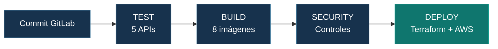

# FinTech Nova | Entrega 2

**CI/CD, seguridad y despliegue reproducible en AWS**  
**Trabajo práctico final · DevOps · Grupo 19**

## Resumen ejecutivo

En la primera entrega, FinTech Nova ya podía ejecutarse con Docker Compose, pero su validación y despliegue dependían en gran medida de pasos manuales. En esta segunda etapa incorporamos un proceso centralizado en GitLab que **prueba los cinco servicios de negocio, construye ocho imágenes, ejecuta controles de seguridad y permite desplegar la solución en AWS con Terraform**.

**Resultado verificado:** en la ejecución de referencia se iniciaron los ocho contenedores, MariaDB alcanzó estado `healthy` y la web y las cinco APIs respondieron HTTP `200`. El despliegue se inició mediante un job manual; una vez iniciado, la preparación y las verificaciones se ejecutaron desde el pipeline.

| Antes (Parte 1) | Ahora (Parte 2) | Valor para FinTech Nova |
| --- | --- | --- |
| Validaciones mayormente manuales | Pruebas de cinco APIs y validación de Terraform | Detectar fallas antes de publicar |
| Construcción y despliegue con intervención operativa | Imágenes generadas por commit y proceso de despliegue en GitLab | Trazabilidad y menor variabilidad |
| Controles de seguridad no integrados al flujo | Escaneos de código, secretos, imágenes y configuración | Detectar riesgos más temprano |
| Infraestructura configurada mediante pasos operativos | Recursos de AWS definidos en Terraform | Reproducibilidad y auditoría |
| Verificación manual de funcionamiento | Comprobaciones HTTPS posteriores al despliegue | Evidencia inmediata del estado de los servicios |

## 1. Arquitectura y alcance

La solución comprende cinco APIs de negocio (Clientes, Pagos, Facturas, Tarjetas y Transacciones), una web, una base de datos MariaDB y Traefik como punto de entrada HTTPS. Los ocho componentes se ejecutan en contenedores dentro de una instancia EC2.

**Alcance de disponibilidad:** el despliegue actual utiliza **una única EC2**. Traefik centraliza el ingreso y enruta solicitudes, pero esta configuración **no elimina el punto único de falla** ni garantiza alta disponibilidad.

## 2. Pipeline: del cambio a una versión verificable

El pipeline se define en [`.gitlab-ci.yml`](.gitlab-ci.yml) y usa cuatro stages: `test`, `build`, `security` y `deploy`. Los jobs independientes de una misma etapa pueden ejecutarse en paralelo, especialmente las construcciones de imágenes y los controles de seguridad. Los runners ejecutan los trabajos, las variables CI/CD suministran configuración sensible y los *artifacts* conservan reportes para su revisión.

| Etapa | Qué se verifica o entrega | Por qué importa |
| --- | --- | --- |
| **Test** | Pruebas de las cinco APIs y validación de Terraform | Evitar avanzar con fallas detectables |
| **Build** | Ocho imágenes publicadas en GitLab Container Registry, etiquetadas por commit | Identificar la versión exacta |
| **Security** | Semgrep, Hadolint, Trivy, Gitleaks, YAML y Compose | Identificar riesgos antes del despliegue |
| **Deploy** | Terraform, EC2, Docker Compose y comprobaciones HTTPS | Desplegar de manera repetible y comprobar el resultado |

### Pruebas automatizadas

Se incorporaron pruebas para las APIs desarrolladas en Python, Node.js, Java, .NET y Go. Cubren comportamientos básicos y comprobaciones HTTP, según el servicio. **No equivalen a pruebas exhaustivas de carga, recuperación o integración entre todos los componentes.**

### Publicación y trazabilidad

Las ocho imágenes se publican en GitLab Container Registry con etiquetas vinculadas al commit. El proceso permite asociar código, imágenes y ejecución del pipeline, en lugar de depender de identificar manualmente qué versión se instaló.

## 3. Seguridad: hallazgos y decisiones

| Control | Herramienta | Riesgo atendido |
| --- | --- | --- |
| Código | Semgrep | Patrones de código potencialmente inseguros |
| Imágenes | Trivy | Vulnerabilidades conocidas en paquetes |
| Secretos | Gitleaks | Credenciales expuestas en el repositorio |
| Dockerfiles | Hadolint | Configuraciones y prácticas riesgosas |
| YAML / Compose | Yamllint y validación Compose | Errores de configuración |

**Hallazgo real:** Trivy detectó **cuatro vulnerabilidades HIGH** en imágenes de MariaDB y Facturas. Se revisaron los paquetes afectados, se actualizaron los Dockerfiles, se reconstruyeron las imágenes y se repitieron los análisis. El job de referencia finalizó correctamente.

**Política actual y límite:** el job Trivy tiene `allow_failure: true`. Por lo tanto, aunque el análisis detecte un problema, **no bloquea necesariamente el pipeline**. Para un entorno productivo proponemos bloquear vulnerabilidades críticas explotables, evaluar mitigaciones cuando no exista parche y exigir una aceptación formal y temporal del riesgo antes de cualquier excepción.

Las credenciales de AWS se suministran mediante variables de GitLab CI/CD y no deben guardarse en el repositorio. El acceso y la rotación de esas variables siguen siendo controles operativos necesarios.

Detalle: [SEGURIDAD.md](SEGURIDAD.md).

## 4. Infraestructura y despliegue

Terraform define la infraestructura de AWS en [`infra/aws/`](infra/aws/). La ejecución validada utilizó AWS Academy Learner Lab, una instancia EC2 y reglas de red que habilitan HTTPS por el puerto 443 y restringen SSH al origen autorizado del runner.

**Cómo funciona el despliegue:** se inicia el job `deploy_terraform` en GitLab; el job prepara o actualiza la infraestructura, transfiere las imágenes y configuración necesarias, inicia los contenedores con Docker Compose y verifica los endpoints. Existe también un job alternativo `deploy_aws`, que no se utilizó para la validación final. **El disparo del despliegue sigue siendo manual**; el procedimiento posterior está automatizado.

### Resultado comprobado

- Pipeline de referencia: [#16413](https://labsys.frc.utn.edu.ar/gitlab/desarrollo-y-operaciones-devops/tps-2026/grupo-19/tp-1/-/pipelines/16413), commit `0dc279f0` en `main`.
- Job [deploy_terraform #104532](https://labsys.frc.utn.edu.ar/gitlab/desarrollo-y-operaciones-devops/tps-2026/grupo-19/tp-1/-/jobs/104532): **exitoso**.
- Ocho contenedores iniciados; MariaDB `healthy`.
- Web y cinco APIs: **HTTP 200** en las comprobaciones HTTPS.
- Dashboard Traefik: **HTTP 401 esperado**, por requerir autenticación.
- El pipeline puede verse como **Blocked** por el job manual alternativo `deploy_aws` pendiente. Esto no contradice el éxito del job `deploy_terraform`.

## 5. Disponibilidad e impacto de negocio

**Riesgos mitigados:** los tests reducen la probabilidad de publicar cambios defectuosos; los escaneos permiten detectar vulnerabilidades antes; las verificaciones HTTPS permiten advertir fallas visibles inmediatamente después del despliegue; Terraform reduce el trabajo necesario para recrear la infraestructura.

**Riesgos no resueltos:** la aplicación depende de una sola EC2; no se ha demostrado con estas evidencias recuperación automática, redundancia, respaldo restaurado, tolerancia a fallas ni un tiempo objetivo de recuperación. Una caída de esa instancia podría interrumpir el acceso a la web y las APIs.

**Impacto económico:** no contamos con cifras de operaciones, ingresos por transacción ni costos de indisponibilidad de FinTech Nova; por lo tanto, **no corresponde afirmar una pérdida monetaria real por hora**. Para estimarla usaríamos:

> **Pérdida estimada por hora = operaciones afectadas por hora × margen económico promedio por operación + costos operativos de recuperación + otros costos comprobables.**

La indisponibilidad también puede generar reclamos y pérdida de confianza, aunque estos efectos requieren datos para cuantificarse. Como siguiente paso priorizamos monitoreo y alertas, pruebas de recuperación, respaldos verificados y redundancia para reducir el impacto de la falla de una instancia.

## 6. Evidencias

Guardar las capturas en [`docs/evidencias/`](docs/evidencias/) con los nombres siguientes. Cada imagen se muestra también en su sección correspondiente.

| Archivo | Evidencia |
| --- | --- |
| `arquitectura-devops.png` | Arquitectura general de la solución |
| `pipeline-main.png` | Etapas y resultados de GitLab CI/CD |
| `seguridad-trivy.png` | Ejecución del escaneo de imágenes |
| `aws-ec2-instancia.png` | Instancia EC2 en ejecución |
| `aws-ec2-seguridad.png` | Reglas de entrada de red |
| `deploy-terraform.png` | Job exitoso y comprobaciones HTTPS |
| `aplicacion-aws.png` | Aplicación funcionando en el navegador |

## 7. Próximas mejoras priorizadas

1. **Alta prioridad:** definir política de bloqueo de vulnerabilidades críticas en el pipeline y excepciones justificadas.
2. **Alta prioridad:** monitoreo, alertas y pruebas de recuperación ante caída de EC2.
3. **Alta prioridad:** respaldos con restauración comprobada y evaluación de redundancia.
4. **Siguiente iteración:** pruebas de integración y carga, métricas de tiempos de despliegue y recuperación.
5. **Siguiente iteración:** evaluar automatizar el disparo del despliegue con aprobaciones y controles adecuados.

## Documentación complementaria

[README Parte 1](README.md) · [Seguridad](SEGURIDAD.md) · [Errores y soluciones](ERRORES.md) · [AWS EC2](AWS_EC2.md) · [Despliegue](DEPLOY.md) · [Análisis](ANALISIS.md)
