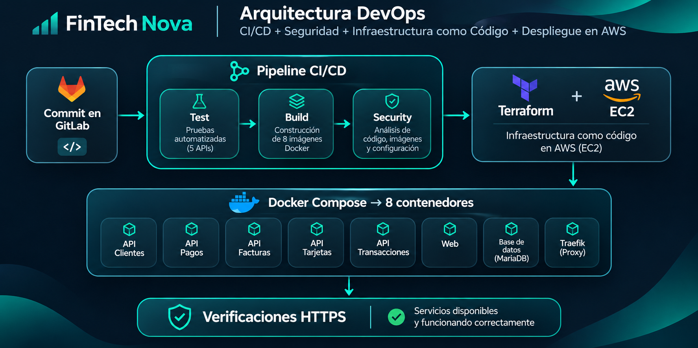
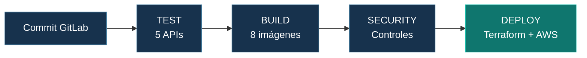
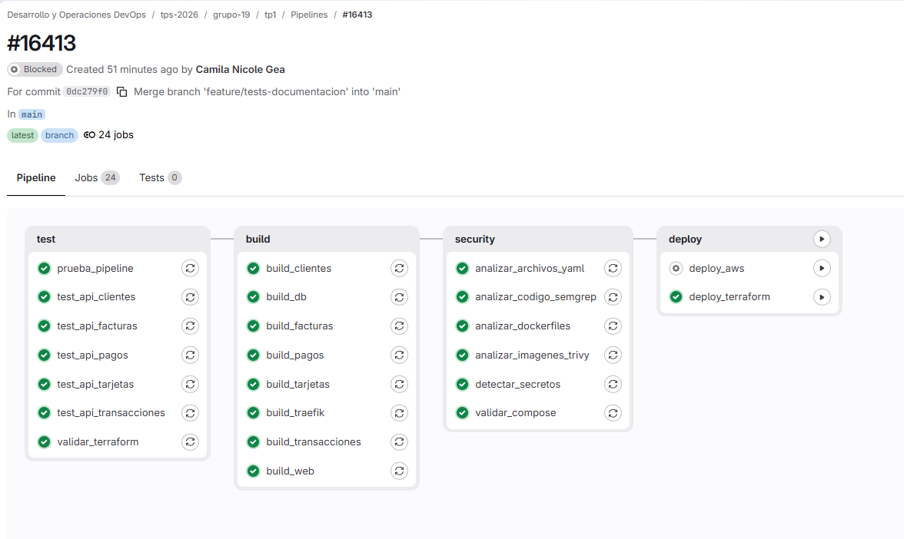
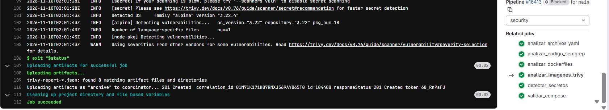
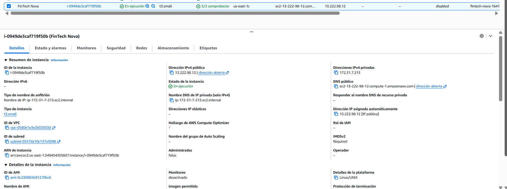
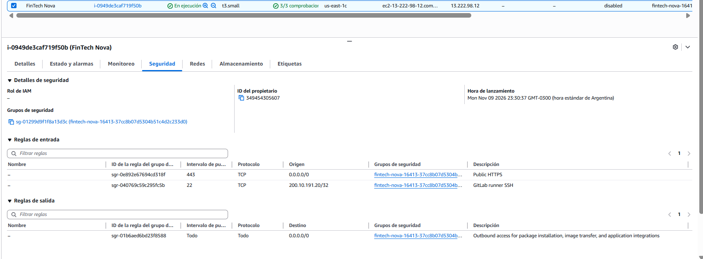
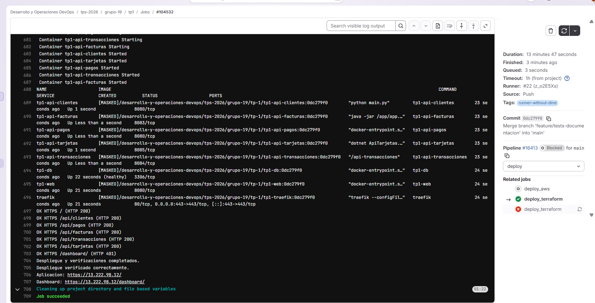

# FinTech Nova | Entrega 2

**CI/CD, seguridad y despliegue reproducible en AWS**  
**Trabajo práctico final · DevOps · Grupo 19**

## Resumen ejecutivo

En la primera entrega, FinTech Nova ya podía ejecutarse con Docker Compose, pero su validación y despliegue dependían en gran medida de pasos manuales. En esta segunda etapa incorporamos un proceso centralizado en GitLab que **prueba los cinco servicios de negocio, construye ocho imágenes, ejecuta controles de seguridad y permite desplegar la solución en AWS con Terraform**.

**Resultado verificado:** en la ejecución de referencia se iniciaron los ocho contenedores, MariaDB alcanzó estado `healthy` y la web y las cinco APIs respondieron HTTP `200`. La política actual despliega automáticamente desde `main` después de que pasan las etapas previas; el job Terraform realiza el aprovisionamiento, la transferencia y las verificaciones dentro del pipeline.

| Antes (Parte 1) | Ahora (Parte 2) | Valor para FinTech Nova |
| --- | --- | --- |
| Validaciones mayormente manuales | Pruebas de cinco APIs y validación de Terraform | Detectar fallas antes de publicar |
| Construcción y despliegue con intervención operativa | Imágenes generadas por commit y proceso de despliegue en GitLab | Trazabilidad y menor variabilidad |
| Controles de seguridad no integrados al flujo | Escaneos de código, secretos, imágenes y configuración | Detectar riesgos más temprano |
| Infraestructura configurada mediante pasos operativos | Recursos de AWS definidos en Terraform | Reproducibilidad y auditoría |
| Verificación manual de funcionamiento | Comprobaciones HTTPS posteriores al despliegue | Evidencia inmediata del estado de los servicios |

## 1. Arquitectura y alcance

La solución comprende cinco APIs de negocio (Clientes, Pagos, Facturas, Tarjetas y Transacciones), una web, una base de datos MariaDB y Traefik como punto de entrada HTTPS. Los ocho componentes se ejecutan en contenedores dentro de una instancia EC2.



**Alcance de disponibilidad:** el despliegue actual utiliza **una única EC2**. Traefik centraliza el ingreso y enruta solicitudes, pero esta configuración **no elimina el punto único de falla** ni garantiza alta disponibilidad.

## 2. Pipeline: del cambio a una versión verificable



El pipeline se define en [`.gitlab-ci.yml`](.gitlab-ci.yml) y usa cuatro stages: `test`, `build`, `security` y `deploy`. Los jobs independientes de una misma etapa pueden ejecutarse en paralelo, especialmente las construcciones de imágenes y los controles de seguridad. Los runners ejecutan los trabajos, las variables CI/CD suministran configuración sensible y los *artifacts* conservan reportes para su revisión.

| Etapa | Qué se verifica o entrega | Por qué importa |
| --- | --- | --- |
| **Test** | Pruebas de las cinco APIs y validación de Terraform | Evitar avanzar con fallas detectables |
| **Build** | Ocho imágenes publicadas en GitLab Container Registry, etiquetadas por commit | Identificar la versión exacta |
| **Security** | Semgrep, Hadolint, Trivy, Gitleaks, YAML y Compose | Identificar riesgos antes del despliegue |
| **Deploy** | Terraform, EC2, Docker Compose y comprobaciones HTTPS | Desplegar de manera repetible y comprobar el resultado |



### Pruebas automatizadas

Se incorporaron pruebas para las APIs desarrolladas en Python, Node.js, Java, .NET y Go. Cubren comportamientos básicos y comprobaciones HTTP, según el servicio. **No equivalen a pruebas exhaustivas de carga, recuperación o integración entre todos los componentes.**

#### Ejemplo de prueba: API Clientes

```yml
test_api_clientes:
  stage: test
  image: python:3.11-slim
  tags: [$RUNNER_TAG]
  before_script:
    - python -m pip install --no-cache-dir -r aplicaciones-contenedores/api-clientes/requirements.txt
  script:
    - cd aplicaciones-contenedores/api-clientes
    - python -m unittest discover -s tests -p 'test_*.py' -v
```
Como ejemplo de las pruebas automatizadas, utilizamos la API de Clientes, desarrollada en Python con Flask.

**Código de referencia:** `aplicaciones-contenedores/api-clientes/tests/`

Las pruebas están definidas en la clase `ClientesApiTests` y se ejecutan desde el job `test_api_clientes` del pipeline.

Para ejecutar estas pruebas utilizamos app.test_client() de Flask, que permite probar las rutas de la API sin levantar un servidor HTTP. En las pruebas que necesitan consultar clientes, utilizamos mocks para simular la respuesta de MariaDB, sin conectarnos a una base de datos real.

Esto permite comprobar el comportamiento del código de Clientes antes de construir las imágenes Docker y desplegar la aplicación.

```python
class ClientesApiTests(unittest.TestCase):
    def setUp(self):
        app.config["TESTING"] = True
        self.client = app.test_client()

    @patch("main.mysql.connect")
    def test_listar_clientes(self, mock_connect):
        cursor = MagicMock()
        cursor.fetchall.return_value = [
            {"id": 1, "nombre": "Cliente de prueba"}
        ]
        mock_connect.return_value.cursor.return_value = cursor

        response = self.client.get("/clientes")

        self.assertEqual(response.status_code, 200)
        self.assertEqual(
            response.get_json()[0]["nombre"],
            "Cliente de prueba"
        )
        cursor.execute.assert_called_once_with(
            "SELECT * FROM clientes"
        )
```
En el ejemplo test_listar_clientes, primero simulamos que la base de datos devuelve un cliente llamado "Cliente de prueba". Luego ejecutamos una consulta a la ruta /clientes y verificamos que la API responda con HTTP 200 y devuelva el nombre esperado. También comprobamos que se haya ejecutado la consulta SQL SELECT * FROM clientes.

De esta manera, validamos el comportamiento del código de la API sin necesidad de levantar MariaDB.

#### Validación de Terraform

Además de las pruebas sobre las APIs, el pipeline incluye el job `validar_terraform`, que comprueba la configuración de la infraestructura antes del despliegue.

```yaml
validar_terraform:
  stage: test
  image:
    name: hashicorp/terraform:1.17.1
    entrypoint: [""]
  tags: [$RUNNER_TAG]
  rules:
    - if: '$CI_COMMIT_BRANCH == "main" || $CI_COMMIT_BRANCH == "deploy/terraform"'
  before_script:
    - apk add --no-cache ca-certificates
  script:
    - terraform fmt -check -recursive infra
    - terraform -chdir=infra/aws init -backend=false -input=false -lockfile=readonly
    - terraform -chdir=infra/aws validate
```

Este job realiza tres operaciones principales:

- **`terraform fmt -check`:** comprueba que los archivos de Terraform respeten el formato esperado.
- **`terraform init -backend=false`:** inicializa Terraform sin configurar el backend remoto.
- **`terraform validate`:** verifica que la configuración de Terraform sea válida.

Estas comprobaciones se ejecutan en las ramas `main` y `deploy/terraform`. No crean recursos en AWS, sino que permiten detectar problemas de configuración antes del despliegue.


### Publicación y trazabilidad

Las ocho imágenes se publican en GitLab Container Registry con etiquetas vinculadas al commit. El proceso permite asociar código, imágenes y ejecución del pipeline, en lugar de depender de identificar manualmente qué versión se instaló.


#### Construcción automatizada de imágenes Docker

Para construir las ocho imágenes utilizamos un job reutilizable llamado `.build_image`, definido en `.gitlab-ci.yml`.

Este job contiene las instrucciones comunes para iniciar sesión en GitLab Container Registry, construir una imagen Docker y publicarla con dos etiquetas: la del commit y `latest`.

```yaml
.build_image:
  stage: build
  image: docker:29.8.1-cli
  tags: [$BUILD_RUNNER_TAG]
  script:
    - test -n "$CI_REGISTRY" || { echo "CI_REGISTRY vacío"; exit 1; }
    - test -n "$CI_PROJECT_PATH" || { echo "CI_PROJECT_PATH vacío"; exit 1; }
    - export IMAGE_REF="$CI_REGISTRY/$CI_PROJECT_PATH/$IMAGE_NAME"
    - echo "Construyendo y publicando $IMAGE_REF:$IMAGE_TAG"
    - echo "$CI_REGISTRY_PASSWORD" | docker login "$CI_REGISTRY" --username "$CI_REGISTRY_USER" --password-stdin
    - docker build --pull --platform linux/amd64 -t "$IMAGE_REF:$IMAGE_TAG" -t "$IMAGE_REF:latest" -f "$DOCKERFILE" "$BUILD_CONTEXT"
    - docker push "$IMAGE_REF:$IMAGE_TAG"
    - docker push "$IMAGE_REF:latest"
```

**¿Qué realiza este job?**

- `docker login`: autentica al runner en GitLab Container Registry.
- `docker build`: construye la imagen utilizando el Dockerfile y el contexto correspondientes.
- `docker push`: publica la imagen en el registro.
- `IMAGE_TAG`: identifica la imagen mediante el identificador corto del commit (`CI_COMMIT_SHORT_SHA`).
- `latest`: identifica la versión publicada con esa etiqueta, aunque puede cambiar con nuevas construcciones.

#### Ejemplo: construcción de la API Clientes

Cada servicio define su propio job, que reutiliza las instrucciones anteriores mediante `extends`.

```yaml
build_clientes:
  extends: .build_image
  variables:
    BUILD_RUNNER_TAG: runner-without-dind
    IMAGE_NAME: tp1-api-clientes
    DOCKERFILE: aplicaciones-contenedores/api-clientes/Dockerfile
    BUILD_CONTEXT: aplicaciones-contenedores/api-clientes
```

En este ejemplo, `build_clientes` reutiliza el job `.build_image`, pero indica qué imagen construir, qué Dockerfile utilizar y dónde se encuentra el código necesario.

El mismo mecanismo se utiliza para los demás servicios: Pagos, Facturas, Tarjetas, Transacciones, web, MariaDB y Traefik.

Como los trabajos de construcción son independientes, GitLab puede ejecutarlos en paralelo cuando hay runners disponibles.


## 3. Seguridad: hallazgos y decisiones

| Control | Herramienta | Riesgo atendido |
| --- | --- | --- |
| Código | Semgrep | Patrones de código potencialmente inseguros |
| Imágenes | Trivy | Vulnerabilidades conocidas en paquetes |
| Secretos | Gitleaks | Credenciales expuestas en el repositorio |
| Dockerfiles | Hadolint | Configuraciones y prácticas riesgosas |
| YAML / Compose | Yamllint y validación Compose | Errores de configuración |


### Implementación de controles de seguridad

Los controles se ejecutan automáticamente mediante jobs definidos en `.gitlab-ci.yml`.

#### Análisis de código con Semgrep

Semgrep analiza el código fuente para detectar posibles patrones inseguros.

```yaml
analizar_codigo_semgrep:
  stage: security
  image: semgrep/semgrep:latest
  tags: [$RUNNER_TAG]
  script:
    - semgrep --config auto --severity ERROR --json --output semgrep-report.json --error . || status=$?
    - test -s semgrep-report.json
    - exit "${status:-0}"
  artifacts:
    when: always
    paths: [semgrep-report.json]
    expire_in: 1 week
```

Este job ejecuta Semgrep sobre el proyecto, genera un reporte JSON y permite detectar hallazgos de severidad ERROR. El reporte queda disponible como artefacto del pipeline durante una semana.


#### Análisis de imágenes con Trivy

Trivy analiza las imágenes Docker publicadas en GitLab Container Registry para identificar vulnerabilidades conocidas.

```yaml
analizar_imagenes_trivy:
  stage: security
  allow_failure: true
  image:
    name: aquasec/trivy:latest
    entrypoint: [""]
  tags: [$RUNNER_TAG]
  script:
    - export IMAGE_REF="$CI_REGISTRY/$CI_PROJECT_PATH"
    - export TRIVY_USERNAME="$CI_REGISTRY_USER"
    - export TRIVY_PASSWORD="$CI_REGISTRY_PASSWORD"
    - status=0
    - |
      for image in tp1-traefik tp1-db tp1-api-clientes tp1-api-pagos tp1-api-facturas tp1-api-tarjetas tp1-api-transacciones tp1-web; do
        trivy image \
          --username "$TRIVY_USERNAME" \
          --password "$TRIVY_PASSWORD" \
          --format json \
          --output "trivy-report-$image.json" \
          --exit-code 1 \
          --ignore-unfixed \
          --severity HIGH,CRITICAL \
          "$IMAGE_REF/$image:$IMAGE_TAG" || status=$?
      done
    - exit "$status"
  artifacts:
    when: always
    paths: [trivy-report-*.json]
    expire_in: 1 week
```

Este job recorre las ocho imágenes Docker y busca vulnerabilidades de severidad HIGH y CRITICAL.

Los resultados se guardan en reportes JSON que pueden consultarse desde GitLab.

Actualmente, el job utiliza `allow_failure: true`, por lo que los hallazgos no impiden necesariamente que el pipeline continúe. Además, `--ignore-unfixed` excluye del análisis reportado las vulnerabilidades sin corrección disponible.


**Hallazgo real:** Trivy detectó **cuatro vulnerabilidades HIGH** en imágenes de MariaDB y Facturas. Se revisaron los paquetes afectados, se actualizaron los Dockerfiles, se reconstruyeron las imágenes y se repitieron los análisis. El job de referencia finalizó correctamente.

**Política actual y límite:** el job Trivy tiene `allow_failure: true`. Por lo tanto, aunque el análisis detecte un problema, **no bloquea necesariamente el pipeline**. Para un entorno productivo proponemos bloquear vulnerabilidades críticas explotables, evaluar mitigaciones cuando no exista parche y exigir una aceptación formal y temporal del riesgo antes de cualquier excepción.

Las credenciales de AWS se suministran mediante variables de GitLab CI/CD y no deben guardarse en el repositorio. El acceso y la rotación de esas variables siguen siendo controles operativos necesarios.



Detalle: [SEGURIDAD.md](SEGURIDAD.md).

## 4. Infraestructura y despliegue

Terraform define la infraestructura de AWS en [`infra/aws/`](infra/aws/). La ejecución validada utilizó AWS Academy Learner Lab, una instancia EC2 y reglas de red que habilitan HTTPS por el puerto 443 y restringen SSH al origen autorizado del runner.





**Cómo funciona el despliegue:** después de un merge a `main`, el pipeline de tipo `push` ejecuta `deploy_terraform` automáticamente si test, build y los controles bloqueantes de security finalizaron correctamente. El job aplica la infraestructura, transfiere las imágenes y configuración necesarias, inicia los contenedores con Docker Compose y verifica los endpoints. El job legacy `deploy_aws` fue retirado.

**Política de controles:** las pruebas y los controles configurados como obligatorios bloquean el avance si fallan. Trivy analiza vulnerabilidades `HIGH` y `CRITICAL` corregibles y genera artifacts, pero mantiene `allow_failure: true`; por lo tanto, sus hallazgos son informativos y no bloquean por sí solos el despliegue. Los reportes se revisan por separado y no se considera un pipeline verde como prueba de ausencia de CVEs.

**Política de ramas:** `validar_origen_mr` permite integrar a `main` únicamente MRs desde `feature/*`. El deploy se activa por `push` a `main`, no por el nombre de la rama fuente. La protección de `main` debe impedir pushes directos para que el flujo sea exclusivamente por MR.



### Resultado comprobado

- Pipeline de referencia: [#16413](https://labsys.frc.utn.edu.ar/gitlab/desarrollo-y-operaciones-devops/tps-2026/grupo-19/tp-1/-/pipelines/16413), commit `0dc279f0` en `main`.
- Job [deploy_terraform #104532](https://labsys.frc.utn.edu.ar/gitlab/desarrollo-y-operaciones-devops/tps-2026/grupo-19/tp-1/-/jobs/104532): **exitoso**.
- Ocho contenedores iniciados; MariaDB `healthy`.
- Web y cinco APIs: **HTTP 200** en las comprobaciones HTTPS.
- Dashboard Traefik: **HTTP 401 esperado**, por requerir autenticación.
- Este pipeline corresponde a una ejecución histórica, cuando el deploy todavía se iniciaba manualmente. En la política actual `deploy_terraform` es automático en los pipelines `push` de `main`.


## 5. Disponibilidad e impacto de negocio

**Riesgos mitigados:** los tests reducen la probabilidad de publicar cambios defectuosos; los escaneos permiten detectar vulnerabilidades antes; las verificaciones HTTPS permiten advertir fallas visibles inmediatamente después del despliegue; Terraform reduce el trabajo necesario para recrear la infraestructura.

**Riesgos no resueltos:** la aplicación depende de una sola EC2; no se ha demostrado con estas evidencias recuperación automática, redundancia, respaldo restaurado, tolerancia a fallas ni un tiempo objetivo de recuperación. Una caída de esa instancia podría interrumpir el acceso a la web y las APIs. Además, cada `apply` automático puede reemplazar la instancia del state `fintech-nova-sandbox`; el disco raíz tiene `delete_on_termination`, por lo que la base local puede perderse en cada merge. La base de esa EC2 no debe considerarse almacenamiento persistente.

**Impacto económico:** no contamos con cifras de operaciones, ingresos por transacción ni costos de indisponibilidad de FinTech Nova; por lo tanto, **no corresponde afirmar una pérdida monetaria real por hora**. Para estimarla usaríamos:

> **Pérdida estimada por hora = operaciones afectadas por hora × margen económico promedio por operación + costos operativos de recuperación + otros costos comprobables.**

La indisponibilidad también puede generar reclamos y pérdida de confianza, aunque estos efectos requieren datos para cuantificarse. Como siguiente paso priorizamos monitoreo y alertas, pruebas de recuperación, respaldos verificados y redundancia para reducir el impacto de la falla de una instancia.

## 6. Evidencias

Guardar las capturas en [`docs/evidencias/`](docs/evidencias/) con los nombres siguientes. Cada imagen se muestra también en su sección correspondiente.

| Archivo | Evidencia |
| --- | --- |
| `arquitectura-devops.png` | Arquitectura general de la solución |
| `pipeline-main.png` | Etapas y resultados de GitLab CI/CD |
| `seguridad-trivy.png` | Ejecución del escaneo de imágenes |
| `aws-ec2-instancia.png` | Instancia EC2 en ejecución |
| `aws-ec2-seguridad.png` | Reglas de entrada de red |
| `deploy-terraform.png` | Job exitoso y comprobaciones HTTPS |
| `aplicacion-aws.png` | Aplicación funcionando en el navegador |

## 7. Próximas mejoras priorizadas

1. **Alta prioridad:** decidir si Trivy debe pasar de informativo (`allow_failure: true`) a bloqueante para vulnerabilidades `CRITICAL` corregibles; definir excepciones justificadas, temporales y revisables. La política vigente permite que Trivy falle sin bloquear el deploy.
2. **Alta prioridad:** monitoreo, alertas y pruebas de recuperación ante caída de EC2.
3. **Alta prioridad:** respaldos con restauración comprobada y evaluación de redundancia.
4. **Siguiente iteración:** pruebas de integración y carga, métricas de tiempos de despliegue y recuperación.
5. **Siguiente iteración:** reforzar el control de cambios en `main` (rama protegida, MRs obligatorios y pipeline exitoso requerido), ya que un push directo también satisface la regla de deploy basada en `push` a `main`.

## Documentación complementaria

[README Parte 1](README.md) · [Seguridad](SEGURIDAD.md) · [Errores y soluciones](ERRORES.md) · [AWS EC2](AWS_EC2.md) · [Despliegue](DEPLOY.md) · [Análisis](ANALISIS.md) · [Runbooks](docs/runbooks/README.md) · [Postmortems](docs/postmortems/README.md) · [ADRs](docs/adr/README.md)
