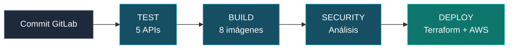
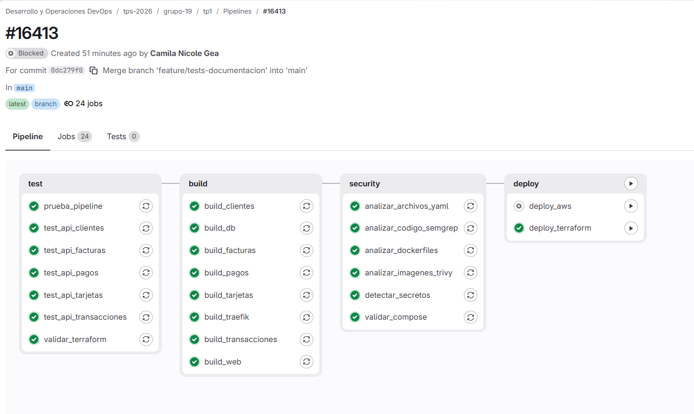
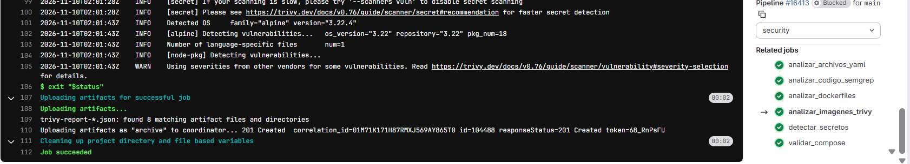
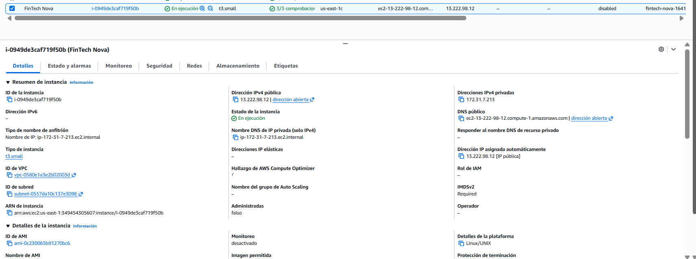
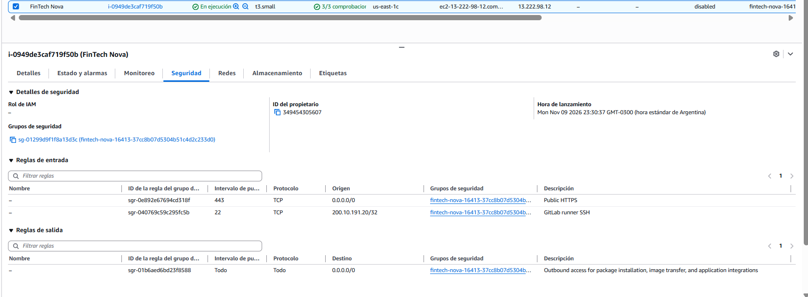
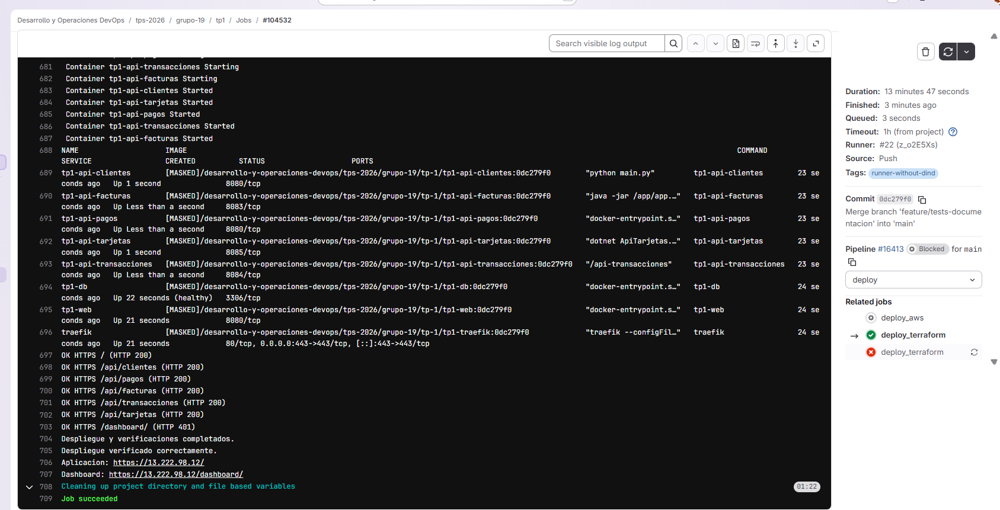

# FinTech Nova

## Parte 2 — Integración continua, seguridad y despliegue en AWS

**Trabajo Práctico Final | Desarrollo y Operaciones (DevOps) | Grupo 19**

FinTech Nova es una aplicación de servicios financieros basada en microservicios. En la primera etapa del proyecto se contenerizaron sus componentes con Docker y se integraron mediante Docker Compose. Esta segunda etapa incorpora automatización de pruebas, construcción y publicación de imágenes, análisis de seguridad y despliegue en AWS mediante infraestructura como código.

## 1. Objetivos

- Automatizar la validación de cambios mediante GitLab CI/CD.
- Incorporar pruebas para las cinco APIs de la aplicación.
- Construir y publicar imágenes Docker identificables por versión.
- Analizar código, dependencias, imágenes y configuraciones para detectar problemas de seguridad.
- Gestionar la infraestructura de AWS con Terraform.
- Desplegar la aplicación y verificar automáticamente su funcionamiento.

## 2. Arquitectura de la aplicación

La solución está formada por ocho contenedores:

| Componente | Tecnología | Responsabilidad |
| --- | --- | --- |
| API Clientes | Python / Flask | Gestión y consulta de clientes |
| API Pagos | Node.js | Operaciones de pagos |
| API Facturas | Java / Spring Boot | Gestión de facturas |
| API Tarjetas | C# / .NET | Operaciones de tarjetas |
| API Transacciones | Go | Registro y consulta de transacciones |
| Web | Aplicación web | Interfaz de usuario |
| Base de datos | MariaDB | Persistencia de información |
| Proxy inverso | Traefik | Enrutamiento de solicitudes y acceso HTTPS |

Los componentes se ejecutan en contenedores Docker y se comunican a través de la red definida en Docker Compose. Traefik recibe las solicitudes externas y las dirige a los servicios correspondientes.

## 3. Pipeline CI/CD

La automatización está definida en [`.gitlab-ci.yml`](.gitlab-ci.yml) y organizada en cuatro etapas: **test**, **build**, **security** y **deploy**.



La definición de etapas en `.gitlab-ci.yml` es:

```yaml
stages:
  - test
  - build
  - security
  - deploy
```


| Etapa | Actividades | Propósito |
| --- | --- | --- |
| **Test** | Pruebas automatizadas de las cinco APIs y validación de Terraform | Detectar errores antes de construir imágenes |
| **Build** | Construcción de ocho imágenes Docker y publicación en GitLab Container Registry | Generar artefactos versionados y reutilizables |
| **Security** | Análisis de código, Dockerfiles, imágenes, secretos y configuraciones | Identificar riesgos y problemas de configuración |
| **Deploy** | Aprovisionamiento de infraestructura, despliegue y comprobaciones | Publicar y validar la aplicación en AWS |

Los trabajos independientes pueden ejecutarse en paralelo. La etapa de despliegue integra Terraform, AWS EC2, Docker Compose y verificaciones HTTPS.

### 3.1. Pruebas automatizadas

Se incorporaron pruebas acordes a la tecnología de cada API:

| API | Herramienta / enfoque |
| --- | --- |
| Clientes | `unittest` y mocks de Python |
| Pagos | `node:test` y verificaciones HTTP |
| Facturas | JUnit y Mockito |
| Tarjetas | Smoke test con compilación, inicio del servicio y consulta HTTP |
| Transacciones | Pruebas HTTP con herramientas de Go |

Estas pruebas comprueban comportamientos básicos y permiten detectar fallas tempranas. No reemplazan las pruebas de integración completas, de rendimiento ni de recuperación.

### 3.2. Construcción y registro de imágenes

La etapa **build** genera las ocho imágenes de la solución y las publica en **GitLab Container Registry**. Se utilizan etiquetas asociadas al commit, lo que permite relacionar cada versión de la aplicación con el código fuente que la originó.

En el despliegue actual, las imágenes se transfieren desde el runner hacia EC2 y se cargan en Docker antes de iniciar los servicios con Compose.

## 4. Seguridad

El pipeline integra herramientas de análisis estático y revisión de artefactos:

| Herramienta | Control realizado |
| --- | --- |
| **Semgrep** | Análisis estático de código y configuraciones |
| **Hadolint** | Revisión de buenas prácticas en Dockerfiles |
| **Trivy** | Detección de vulnerabilidades conocidas en imágenes |
| **Gitleaks** | Detección de posibles secretos en el repositorio |
| **Yamllint** | Validación de archivos YAML |
| **Docker Compose** | Validación de la configuración de servicios |

### 4.1. Vulnerabilidades detectadas y corregidas

Durante las ejecuciones iniciales, **Trivy detectó vulnerabilidades de severidad HIGH** en las imágenes de MariaDB y API Facturas.

A partir de los reportes se identificaron paquetes afectados y se actualizaron los Dockerfiles para incorporar correcciones disponibles. Posteriormente se reconstruyeron las imágenes y se repitieron los análisis. El pipeline de referencia es histórico y se ejecutó antes de establecer el gate bloqueante actual; su resultado no prueba el funcionamiento de la política vigente.

La política vigente de Trivy es bloqueante para hallazgos `HIGH` o `CRITICAL` con corrección disponible. El job usa `--ignore-unfixed`, por lo que las vulnerabilidades sin fix conocido se excluyen del umbral de fallo. Los reportes JSON quedan como artifacts para investigar los hallazgos incluidos. El estado verde solo acredita el resultado de ese análisis, tag/digest, filtros y base de vulnerabilidades concretos.

Las credenciales de AWS y demás valores sensibles se gestionan mediante variables de CI/CD, sin incluir secretos reales en el código fuente.

Más información en [SEGURIDAD.md](SEGURIDAD.md).

## 5. Infraestructura en AWS con Terraform

La infraestructura se define como código mediante **Terraform**, con archivos versionados en [`infra/aws/`](infra/aws/).

El entorno utilizado para el despliegue comprende:

| Recurso | Configuración |
| --- | --- |
| Proveedor cloud | Amazon Web Services (AWS Academy Learner Lab) |
| Región | `us-east-1` |
| Cómputo | Amazon EC2 `t3.small` |
| Sistema de ejecución | Docker y Docker Compose |
| Entrada a la aplicación | HTTPS, puerto `443` |
| Administración | SSH, puerto `22`, restringido a la IP autorizada del runner |
| Estado de Terraform | Backend HTTP remoto |

La definición de infraestructura como código permite versionar los cambios, revisar configuraciones y reproducir el aprovisionamiento de recursos.

### 5.1. Estrategias de despliegue

El pipeline conserva únicamente **`deploy_terraform`** para el despliegue. El job legacy `deploy_aws`, que apuntaba a una instancia existente por SSH, fue retirado.

El despliegue es automático cuando el pipeline de tipo `push` de `main` alcanza `deploy` después de que test, build y security finalizan correctamente. Por lo tanto, al mergear una rama `feature/*` a `main`, el nuevo pipeline de `main` ejecuta Terraform y despliega sin una acción manual. Las ramas feature no despliegan mientras permanecen sin merge.

La condición de CI detecta un push a `main`, no el nombre de la rama fuente. También se desplegaría otro tipo de cambio integrado a `main`; para limitar la política a features, se debe proteger `main`, prohibir pushes directos y aceptar únicamente merge requests desde ramas `feature/*`. La sesión del Learner Lab y las variables protegidas AWS/State deben estar vigentes antes de integrar el cambio.

Terraform conserva el state fijo `fintech-nova-sandbox`. El sufijo/key pair varía por pipeline, por lo que un apply sucesivo puede reemplazar la instancia y su volumen raíz EBS (`delete_on_termination`), perdiendo la base de datos local. Con el deploy automático esto puede ocurrir en cada merge a `main`; esta EC2 no debe usarse para datos persistentes.

## 6. Despliegue y verificación

El proceso de despliegue prepara la instancia EC2, transfiere las imágenes y los archivos necesarios y ejecuta Docker Compose para iniciar los ocho contenedores.

Después del inicio, el job verifica el estado de los servicios y realiza solicitudes HTTPS a la interfaz y a las APIs.

### Resultados obtenidos

**Pipeline:** [#16413](https://labsys.frc.utn.edu.ar/gitlab/desarrollo-y-operaciones-devops/tps-2026/grupo-19/tp-1/-/pipelines/16413)  
**Commit:** `0dc279f0` (`main`)  
**Despliegue Terraform:** [Job #104532](https://labsys.frc.utn.edu.ar/gitlab/desarrollo-y-operaciones-devops/tps-2026/grupo-19/tp-1/-/jobs/104532) — exitoso

| Verificación | Resultado |
| --- | --- |
| Pruebas automatizadas de las cinco APIs | Correctas |
| Construcción de las ocho imágenes | Correcta |
| Controles de seguridad del pipeline | Jobs finalizados correctamente |
| Contenedores de la aplicación | Ocho iniciados |
| MariaDB | Estado `healthy` |
| Interfaz web (`/`) | HTTP `200` |
| API Clientes (`/api/clientes`) | HTTP `200` |
| API Pagos (`/api/pagos`) | HTTP `200` |
| API Facturas (`/api/facturas`) | HTTP `200` |
| API Transacciones (`/api/transacciones`) | HTTP `200` |
| API Tarjetas (`/api/tarjetas`) | HTTP `200` |
| Dashboard Traefik (`/dashboard/`) | HTTP `401` — autenticación requerida |

El job `deploy_terraform` finalizó con el mensaje de despliegue verificado correctamente. Esa ejecución constituye evidencia histórica; con la política actual, los nuevos pipelines `push` de `main` lanzan el job automáticamente y ya no quedan bloqueados por un job manual alternativo pendiente.

La IP pública de la instancia depende de la sesión de AWS Academy y puede cambiar al reiniciar o recrear los recursos.

## 7. Evidencias

Las capturas se almacenan en [`docs/evidencias/`](docs/evidencias/) y documentan la ejecución real del proyecto. Los nombres y rutas son los siguientes:

| Evidencia | Archivo | Sección relacionada |
| --- | --- | --- |
| Arquitectura general del sistema | `arquitectura-devops.png` | 2. Arquitectura |
| Pipeline principal con sus etapas | `pipeline-main.png` | 3. Pipeline CI/CD |
| Resultado del análisis de Trivy | `seguridad-trivy.png` | 4. Seguridad |
| Instancia EC2 en ejecución | `aws-ec2-instancia.png` | 5. Infraestructura |
| Reglas de entrada de EC2 | `aws-ec2-seguridad.png` | 5. Infraestructura |
| Log de despliegue y verificaciones HTTPS | `deploy-terraform.png` | 6. Despliegue |
| Interfaz de FinTech Nova en AWS | `aplicacion-aws.png` | 6. Despliegue |

Las capturas del pipeline y del despliegue se pueden consultar también en los enlaces a GitLab incluidos en la sección 6.

<!-- Al incorporar cada captura al repositorio, se puede mostrar dentro del README con:






-->

## 8. Beneficios y oportunidades de mejora

La incorporación de CI/CD y de infraestructura como código aporta:

- **Menos tareas manuales:** pruebas, construcción, análisis y verificaciones ejecutados desde el pipeline.
- **Mayor trazabilidad:** asociación entre commits, imágenes construidas y despliegues.
- **Detección temprana:** identificación de errores y vulnerabilidades antes de publicar cambios.
- **Reproducibilidad:** infraestructura y configuración de servicios definidas en archivos versionados.
- **Validación del resultado:** comprobaciones HTTP posteriores al despliegue.

En un sistema financiero, una interrupción puede impedir consultas y operaciones, generar costos operativos y afectar la confianza de los usuarios. La automatización reduce algunos riesgos, pero no garantiza disponibilidad continua.

### Próximos pasos

- Incorporar pruebas de integración, carga y recuperación.
- Implementar monitoreo y alertas.
- Evaluar redundancia para evitar depender de una única instancia EC2.
- Definir políticas de bloqueo para vulnerabilidades críticas.
- Mejorar la gestión de certificados TLS, respaldos y recuperación ante fallos.

## 9. Documentación complementaria

| Documento | Contenido |
| --- | --- |
| [README.md](README.md) | Documentación de la primera etapa |
| [SEGURIDAD.md](SEGURIDAD.md) | Herramientas de análisis y correcciones |
| [ERRORES.md](ERRORES.md) | Problemas encontrados y soluciones |
| [AWS_EC2.md](AWS_EC2.md) | Configuración del entorno AWS |
| [DEPLOY.md](DEPLOY.md) | Procedimientos de despliegue |
| [scripts/README.md](scripts/README.md) | Inventario de scripts operativos |
| [docs/adr/README.md](docs/adr/README.md) | Decisiones de arquitectura y operación (ADRs) |
| [docs/runbooks/README.md](docs/runbooks/README.md) | Procedimientos operativos repetibles |
| [docs/postmortems/README.md](docs/postmortems/README.md) | Análisis de incidentes y acciones preventivas |
| [ANALISIS.md](ANALISIS.md) | Análisis técnico del proyecto |

---

**FinTech Nova — Grupo 19 | Trabajo Práctico Final de DevOps**
